# Prueba 3D: estilo visual y personajes

Esta carpeta tiene dos etapas del mismo trabajo.

1. **La prueba de estilo.** La misma escena hecha por dos caminos 3D, para elegir. **El usuario eligió el camino B, 3D toon en tiempo real, con la escala media** (18 de noviembre de 2026). En su celular los dos caminos andan a 60 fps.
2. **Los personajes.** Es lo más nuevo: animación con carácter sobre el camino B. Locomoción que no patina, golpes, reacciones, manías, caras y tres personajes del elenco hechos con un solo modelo.

| | Qué es | Dónde verlo |
| --- | --- | --- |
| **Personajes** | Página de revisión: los 24 clips en loop, con selector de personaje, vista, velocidad y cara | [`personajes.html`](personajes.html) · [Artifact privado](https://claude.ai/artifact/FgWCq9Rar7xma4vdNPkyiP) |
| **B** | El peloteo en 3D toon en tiempo real, ya con los clips nuevos | [`tiempo-real.html`](tiempo-real.html) · [Artifact](https://claude.ai/artifact/7rELuoDGFn3hTNNPiHbtzL) |
| **A** | El mismo peloteo con sprites prerrenderizados. Quedó como estaba cuando se decidió | [`sprites.html`](sprites.html) · [Artifact privado](https://claude.ai/artifact/QhRsg8nWnyou6DNKdaT5ua) |

Los Artifacts privados solo los abre su dueño. La página de personajes y la B tienen un botón para pasar de una a la otra.

Este documento tiene, en orden:

1. [Personajes y animación](#personajes-y-animación): qué hay, cómo verlo, cuánto pesa, qué se verificó y la autocrítica.
2. [Contrato para el motor](#contrato-para-el-motor): el formato del archivo y cómo usar cada dato.
3. La prueba de estilo: cómo verla, qué comparten las dos versiones, cómo está hecha cada una, capturas, comparación, mediciones, autocrítica y recomendación.
4. Cómo se regenera todo y de dónde sale cada asset.

## Personajes y animación

El pedido fue claro: lo importante es la animación. Las siluetas propias de cada personaje se hicieron solo donde no suman peso.

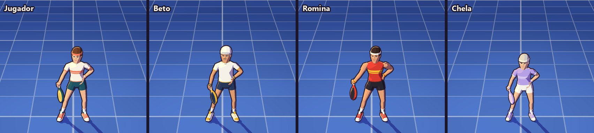

### Cómo verlos

En el celular, con el Artifact de la tabla. En la computadora:

```bash
node design/prueba-3d/herramientas/servir.mjs
```

y abrir `http://127.0.0.1:4330/personajes.html`.

La página muestra un personaje sobre un piso cuadriculado de un metro. **El piso corre con el desplazamiento que declara cada clip.** Si un pie patina, se ve contra las líneas.

- **Personaje**: Jugador, Beto, Romina o Chela.
- **Moverse, Golpes, Gestos**: los clips de cada grupo. La estrella marca la manía del personaje elegido.
- **Todos**: los 24 clips a la vez, al tamaño en que se ven jugando. Tocando uno se lo ve grande.
- **Vista**: como ve la cámara del juego al rival, como ve al jugador propio (de espaldas), de costado y de cerca, a la cara.
- **Cara**: sola (la que marca cada clip, más el parpadeo) o fija en una expresión.
- **Velocidad**: normal, a la mitad o a un cuarto. **Pausa** congela el cuadro.
- **Rumbo**: recto o en diagonal. Muestra el giro de pelvis con el que un solo clip de correr sirve para todas las direcciones.
- **Pies**: normales o grandes. Es la prueba de estilización, para compararla en vivo.

En los golpes, una pelota llega al centro de la pala justo en el cuadro de contacto y sale para el otro lado. «Carrera completa» encadena espera, arranque, correr y frenada.

Parámetros de la URL en local: `?personaje=beto`, `?clip=derecha`, `?vista=juego|espalda|lado|cara`, `?t=0.52` (congela ese instante del clip), `?vel=0.25`, `?cara=esfuerzo`, `?rumbo=1`, `?pies=1` y `?todos=1`.

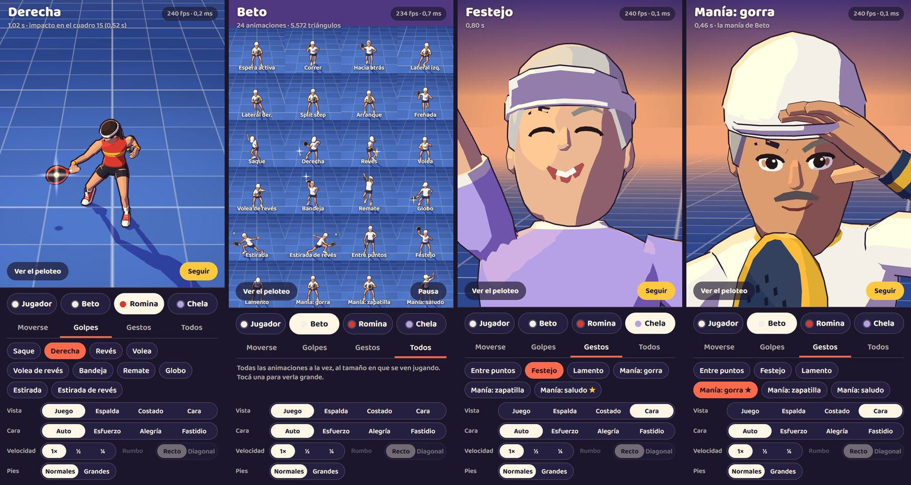

En la escena del peloteo (`tiempo-real.html`) se elige el rival con `?rival=beto`, `?rival=romina` o `?rival=chela`.

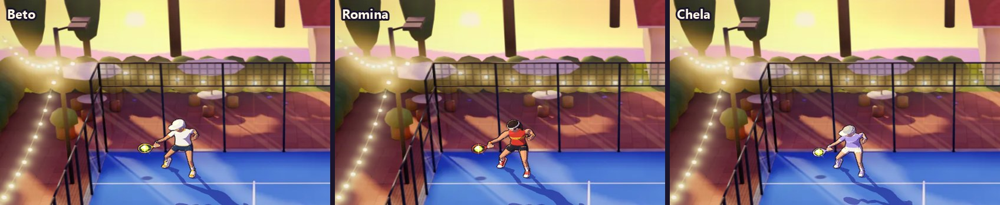

### Un modelo, cuatro personajes

Todos comparten la malla, el esqueleto y los clips. Lo que cambia son datos chicos del mismo archivo.

| | Jugador | Beto, «el Profe» | Romina, «la Topadora» | Chela, «la Astronauta» |
| --- | --- | --- | --- | --- |
| Paleta | Crema, coral y verde petróleo | Chomba blanca con vivos mostaza, short azul, canas | Rojo, amarillo y negro. Musculosa | Lavanda y blanco, rulos grises |
| Piezas | Trenza | Gorra, ala y bigote | Trenza | Ala (con la vincha hace de visera) |
| Escala de huesos | — | Panza hacia adelante, piernas más finas | Hombros y brazos más anchos | Cabeza más grande, torso y caderas más redondos |
| Tamaño | 1,00 | 1,00 | 1,00 | 0,90 |
| Postura | — | Echado un poco atrás, por la panza | Pecho afuera | Algo encorvada |
| Tempo de los gestos | 1,00 | 0,90 | 1,00 | 1,10 |
| Amplitud | 1,00 | 0,88 | 1,14 | 0,94 |
| Manía | Zapatilla | Se acomoda la gorra | Golpea la zapatilla con la pala | Saluda a la tribuna |

- **La musculosa no es otra malla.** La manga tiene su propio material: con el color de la piel queda el hombro al aire.
- **La gorra de Beto** es un casquete de 85 vértices sobre el pelo, más el ala. La visera de Chela es la misma ala con la vincha de siempre.
- **El ala es corta y va levantada.** Una visera larga tapa los ojos desde la cámara alta del juego; por eso en la ronda 1 se cambió por una vincha.
- **Escala de huesos** quiere decir que cada hueso agranda su parte de la malla sin tocar la animación. La panza de Beto es la columna escalada 1,38 hacia adelante. No cuesta nada por cuadro.
- **Tempo y amplitud** hacen que el mismo clip no se vea igual en los tres. La amplitud exagera o achica cuánto se aparta el tren superior de la posición de espera.
- **Todo esto pesa 2,5 KB**: 1,4 la gorra, 0,9 el ala y 0,2 el bigote (comprimido con gzip). Las paletas, las escalas y las posturas son números del JSON.

Lo que no se hizo, por peso o por tiempo: los anteojos de sol de Chela, el silbato y el reloj de Beto, la segunda muñequera de Romina (las dos muñequeras comparten material), los rulos como geometría y la pollera de Chela, que es un short blanco.

### Locomoción que no patina

Cada ciclo es una función de la fase. Mientras un pie está apoyado, su bola se mueve en línea recta y a velocidad constante, en contra del avance: exactamente lo que recorre el piso. Al terminar el vuelo, el pie ya viene a la velocidad del piso, así que tampoco frena al caer.

Por eso alcanza con una regla: **quien dibuja avanza la fase con la distancia real** (`fase += distancia / zancada`). El pie queda clavado a cualquier velocidad.

| Clip | Dura | Zancada | Velocidad nominal | Qué es |
| --- | --- | --- | --- | --- |
| `correr` | 0,43 s | 1,80 m | 4,2 m/s | Carrera con vuelo: bien inclinada, rodillas arriba y talón a la cola |
| `correr_atras` | 0,40 s | 1,30 m | 3,3 m/s | Carrera hacia atrás propia: pasos cortos sobre las puntas, cola atrás, pala arriba y la vista en la pelota alta |
| `lateral_izq`, `lateral_der` | 0,40 s | 1,35 m | 3,4 m/s | Galope de costado sin cruzar los pies: cae el pie de adelante, cierra el de atrás, empuja y vuela |
| `arranque` | 0,30 s | avanza 0,62 m | — | De la espera a correr. Termina en un cuadro exacto del ciclo de correr |
| `frenada` | 0,47 s | avanza 0,46 m | — | De correr a la espera. Clava el talón adelante, se echa atrás, cae abierto y absorbe |
| `split_step` | 0,80 s | — | — | El saltito de preparación. Cae a los 0,335 s; conviene que caiga cuando el rival le pega |

- La zancada es lo que avanza el personaje en un ciclo completo (dos pasos), con el personaje a escala 1. En la cancha se multiplica por la escala con la que se lo dibuja.
- **Arranque y frenada también van por distancia.** Cada uno trae una tabla con lo que lleva recorrido en cada cuadro. Con eso, los pies no patinan aunque el motor acelere o frene a su manera.
- **Una sola carrera para todas las direcciones.** Para correr en diagonal se gira la pelvis hacia donde va; las piernas giran con ella. El contragiro se reparte entre la columna y el pecho, que sigue mirando a la red. La página lo muestra a 35°; el peloteo lo usa con tope en 50°. Con los cuatro ciclos (adelante, atrás y los dos laterales) se cubre toda la vuelta.
- **El peloteo de la escena B ya usa todo esto**: cada jugador espera, hace el split step, se mueve con los pasos atados a la distancia, y la corrida larga hacia la red arranca y frena con sus clips.

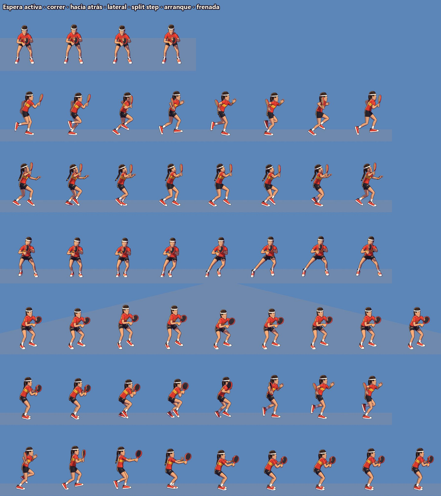

### Golpes

Diez golpes: saque por abajo, derecha, revés, volea, volea de revés, bandeja, remate, globo y dos estiradas (de derecha y de revés).

Todos tienen la misma estructura, y es la que da el carácter:

1. **Anticipación lenta.** Sale de la espera y se arma. El armado termina en una pausa.
2. **Impacto seco.** Descarga en poco más de un décimo de segundo y atraviesa el contacto sin frenar.
3. **Seguimiento que frena.** Sigue de largo, frena y recién ahí vuelve.

Las poses van más lejos que las reales: más giro de hombros, más flexión y más extensión. En el remate salta con tijera y le pega arriba de todo; en el globo sale de bien abajo y todo el cuerpo sube detrás de la pelota; en las estiradas el cuerpo se tira detrás de la pala y el brazo libre equilibra. Las estiradas llegan a 1,35 m del eje del personaje.

Cada golpe marca su **cuadro de contacto**, la posición de la pala y de la mano en ese cuadro, hacia dónde apunta la pala y el tramo del armado que se puede estirar. Está todo en el [contrato](#contrato-para-el-motor).

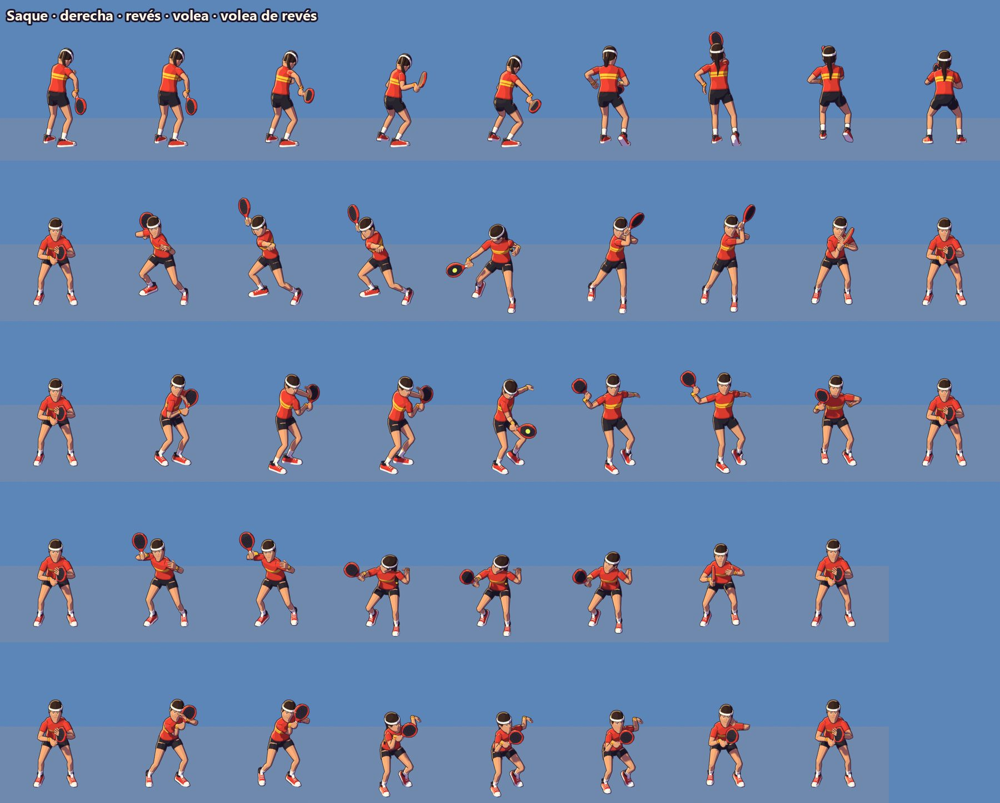

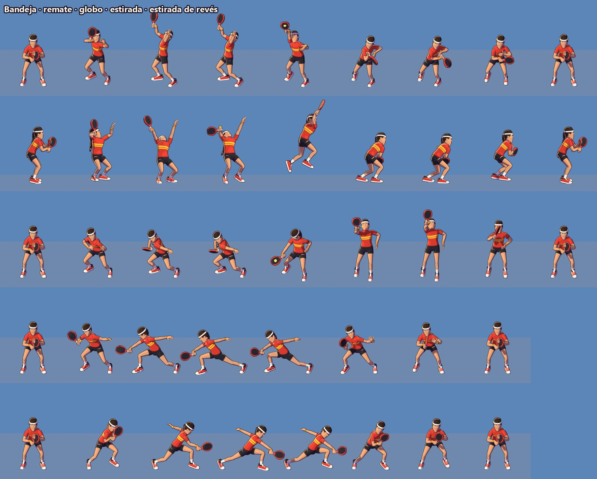

### Reacciones y manías

- **`festejo`** (0,8 s): se junta, salta y clava la pala arriba. Cara de alegría.
- **`lamento`** (0,8 s): se desinfla, mira el piso y niega con la cabeza. Cara de fastidio.
- **`espera`**: la pose entre puntos. Suelta el cuerpo, carga el peso sobre una pierna, mano a la cintura y la pala colgando. **Es un loop de 2 s, no un gesto de un tiro**: no bloquea nada porque se corta en cualquier cuadro. Se pidió «1 s o menos»; un ciclo de respiración de 1 s se veía agitado.
- **Manías**, compartidas por todos. Cada personaje usa la suya con su tempo y su amplitud:
  - `mania_gorra` (0,46 s): dos dedos al ala y un tironcito. En Chela se lee como acomodarse la visera; en Romina, la vincha.
  - `mania_zapatilla` (0,56 s): levanta el pie y le da dos golpecitos a la suela con la pala.
  - `mania_saludo` (0,70 s): gira, levanta la mano y saluda dos veces. Con sonrisa.

Ninguno pasa de 0,8 s y ninguno mueve los pies de lugar, salvo el pie que se levanta en la manía de la zapatilla.

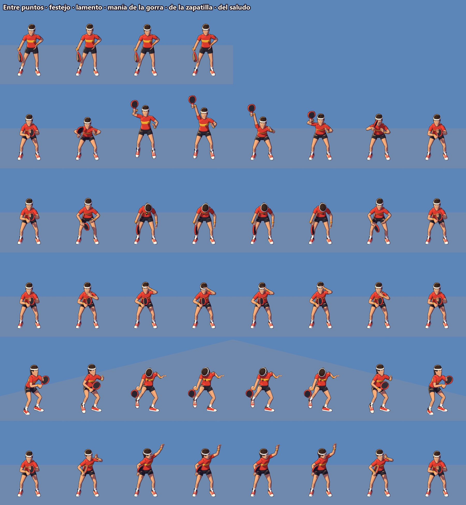

### Caras

Cuatro expresiones además de la normal: **parpadeo, esfuerzo, alegría y fastidio**. Son «shape keys»: cada una mueve los mismos 130 vértices de la cara (ojos, párpados, cejas, boca y una fila de dientes que solo aparece cuando la boca se abre).

- Cada clip marca en qué tramo va cada expresión: esfuerzo alrededor del impacto, alegría en el festejo y en el saludo, fastidio en el lamento.
- El parpadeo lo dispara quien dibuja, cada 2 a 5 segundos.
- Los vértices se mezclan en la CPU y se suben a la GPU solo cuando cambian los pesos.

**Costo medido**, con `herramientas/medir-personajes.mjs`:

| | |
| --- | --- |
| Datos | 3,1 KB sin comprimir, 1,6 KB con gzip |
| Una actualización de cara | 22 µs en esta PC (mezcla en la CPU y subida de 780 bytes). Con la CPU frenada 4×, unos 87 µs |
| JavaScript por cuadro, un personaje, CPU 4× | 0,50 ms con caras y 0,36 ms sin caras |
| JavaScript por cuadro, los 24 clips a la vez, CPU 4× | 2,21 ms con caras y 2,03 ms sin caras |
| GPU por cuadro (Radeon 780M integrada, DPR 2) | 0,86 ms con caras y 0,87 ms sin caras: no cambia |

En el peloteo de la escena B, con dos personajes, apagar las caras (`?caras=0`) no cambia el trabajo por cuadro de forma medible.

**A tamaño de juego las caras casi no se ven**: la cabeza del rival mide unos 8 píxeles. Sirven para la vista de cerca, para un busto en el marcador y para una repetición.

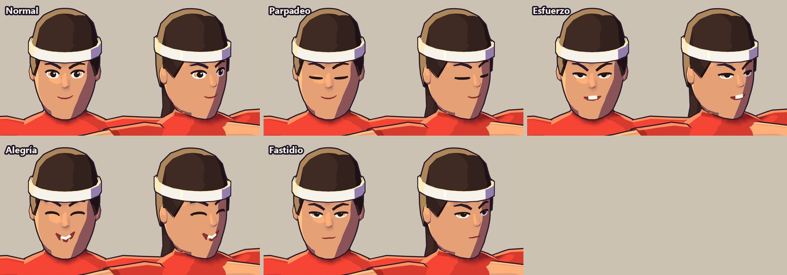

### Malla más liviana

| | Ronda 3 | Ahora (cuerpo base) |
| --- | --- | --- |
| Vértices | 7.309 | 4.205 |
| Triángulos | 10.370 | 5.330 |
| Peso de la malla, sin comprimir | 179 KB | 99 KB |
| Peso de la malla, con gzip | 95 KB | 52 KB |

De dónde salió:

- **Zapatillas**: de 552 a 196 vértices cada una. Suela y capellada de 8 lados, cuello de 4, y los cordones pasaron de tres tubos a tres tiras planas.
- **Dedos**: de 4 lados y con la punta en un solo vértice. De 482 a 198 vértices entre las dos manos.
- **Agujeros de la pala**: 19 rombos por cara en vez de 35 hexágonos. De 490 a 152 vértices. La pala entera pasó de 780 a 258.
- **Lo que no se ve no se exporta**: la pierna termina adentro de la media, el brazo empieza adentro de la manga y la cabeza no tiene coronilla debajo del pelo. Las piernas pasaron de 544 a 284 vértices y los brazos, de 404 a 228.
- **Filas a mano en vez de subdivisión pareja**: piernas, brazos y cabeza llevan más anillos donde se doblan o donde se ven de perfil, y menos en el resto.
- La cara, al revés, ganó filas: de cerca se veía facetada.

A tamaño de juego no se nota la diferencia. De cerca, las zapatillas y los dedos se ven más facetados que antes.

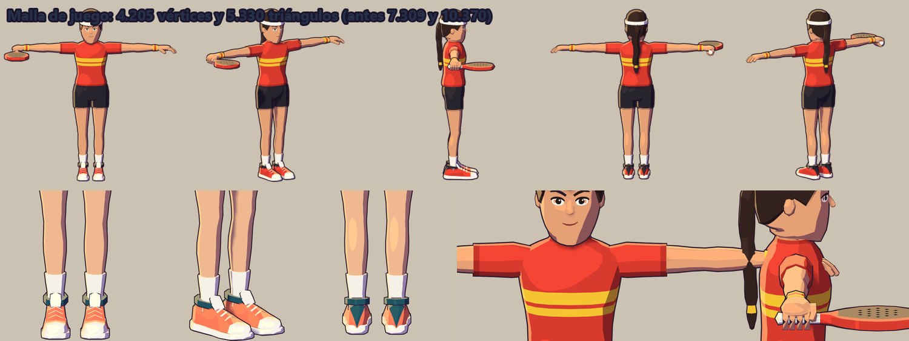

### Prueba de estilización

Se probó la más barata de las tres ideas: **zapatillas más grandes (1,30× en vez de 1,13×) y tobillo y canilla un 17 % más finos**.

- **Al tamaño de juego mejora un poco la lectura de los pies**, sobre todo de espaldas y en el paso lateral. No es un cambio grande.
- De cerca, las zapatillas grandes le dan un aire más de dibujo.
- **Quedó como opción, no como modelo por defecto**: es una decisión de gusto. Se compara en vivo con el selector «Pies» de la página (ahí está hecha con escala de huesos) y se exporta en la malla con `ESTILO=marcado`.
- **Piernas más largas no se hizo.** Alargar las piernas cambia a qué altura queda la cadera en cada pose. Con escala de huesos los pies se despegan del piso o lo atraviesan, y cambiar el esqueleto obliga a retocar las manos de todas las poses.

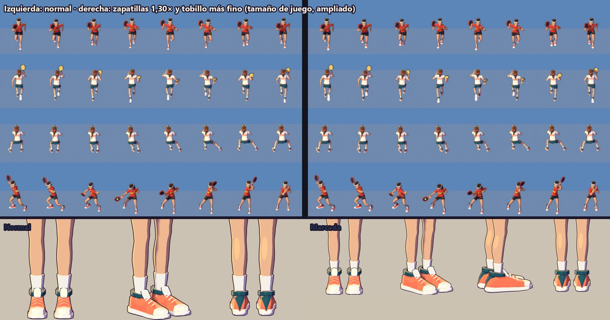

### Cuánto pesa

Medido con `herramientas/pesar.mjs`, que parte el archivo y comprime cada parte por separado. Por eso la suma da un poco más que el archivo entero. KB de 1.000 bytes.

| Parte | Sin comprimir | gzip | brotli | |
| --- | --- | --- | --- | --- |
| Malla base (cuerpo, ropa, pala y cara) | 99,3 | 51,6 | 31,6 | 4.205 vértices, 5.330 triángulos |
| Pieza: trenza | 6,5 | 3,5 | 2,5 | 302 vértices |
| Pieza: gorra | 2,3 | 1,4 | 1,0 | 85 vértices |
| Pieza: ala | 1,7 | 0,9 | 0,7 | 74 vértices |
| Pieza: bigote | 0,2 | 0,2 | 0,2 | 10 vértices |
| Caras: 4 expresiones | 3,1 | 1,6 | 1,3 | 130 vértices que se mueven |
| Clips: espera activa | 6,2 | 1,7 | 1,5 | 1 clip, 30 cuadros |
| Clips: locomoción | 20,4 | 8,8 | 7,7 | 7 clips, 99 cuadros |
| Clips: golpes | 62,0 | 30,2 | 25,4 | 10 clips, 301 cuadros |
| Clips: reacciones | 22,7 | 6,3 | 5,4 | 3 clips, 110 cuadros |
| Clips: manías | 10,9 | 4,7 | 4,1 | 3 clips, 53 cuadros |
| Metadatos (JSON) | 18,4 | 3,7 | 3,2 | Huesos, paletas, personajes y clips |
| **Archivo completo** | **253,6** | **115,0** | **83,5** | 4.676 vértices, 5.848 triángulos, 24 clips |

Contra la ronda 3:

| | Ronda 3 | Ahora |
| --- | --- | --- |
| Archivo, con gzip | 132 KB | 115 KB |
| Clips | 10, en 274 cuadros | 24, en 593 cuadros |
| Peso de los clips, con gzip | 34 KB | 52 KB |
| Personajes | 1, con dos paletas | 4 |
| Caras | 1 | 5 |

- **Hay más del doble de animación y el archivo pesa menos.** Lo pagó la dieta de la malla.
- **Los clips son ahora la mitad del peso.** Un golpe pesa entre 2 y 4 KB; un ciclo de locomoción, 1,2 a 1,6 KB.
- Los giros se guardan con 11 bits por componente en vez de 16. Ahorra un 30 % en los clips. El costo: un pie quieto se mueve hasta 1,5 mm, contra 0,1 mm con 16 bits. Con 10 bits se ahorran otros 6 KB y el pie quieto se mueve hasta 3,5 mm; no se hizo para que no tiemble en la vista de cerca.
- **GitHub Pages**: no se verificó que comprima los `.bin`. Si no lo hace, viajarían los 254 KB enteros. Hay dos salidas: publicarlo ya comprimido y abrirlo con `DecompressionStream('gzip')`, o servirlo con una extensión que el hosting sí comprima.

Por clip, con gzip, en KB: listo 1,7 · correr 1,6 · correr_atras 1,2 · lateral_izq 1,2 · lateral_der 1,2 · split_step 1,8 · arranque 1,3 · frenada 1,6 · saque 3,9 · derecha 3,6 · reves 3,3 · volea 2,2 · volea_reves 2,1 · bandeja 3,5 · remate 4,2 · globo 3,6 · estirada 2,9 · estirada_reves 3,0 · espera 1,8 · festejo 2,5 · lamento 2,1 · mania_gorra 1,2 · mania_zapatilla 1,8 · mania_saludo 2,0.

### Qué se verificó

Sobre el archivo exportado y con el mismo código que usa el navegador, sin navegador:

```bash
node design/prueba-3d/herramientas/verificar-pasos.mjs
```

El detalle por clip está en [`pasos.json`](pasos.json).

- **Los pies no patinan.** Un pie apoyado se aparta, como mucho, 7,7 mm de donde apoyó (el pie de atrás del paso lateral). En correr son 4,5 mm; en el resto de la locomoción, menos de 3,5 mm. Al tamaño de juego, 7,7 mm es un tercio de píxel.
- **De dónde sale ese resto**: los clips se guardan a 30 cuadros por segundo y entre cuadro y cuadro se interpola. Con los giros a 16 bits el número casi no cambia (7,2 mm): es la interpolación, no la precisión. En la fuente, antes de exportar, el pie apoyado se mueve 1,6 mm como mucho en la locomoción (`blender/verificar_pasos.py`).
- **Los empalmes son exactos**: de la espera al arranque, del arranque a correr, de correr a la frenada y de la frenada a la espera, la última pose de un clip y la primera del siguiente coinciden (0,0 mm).
- **El contacto es exacto**: en el cuadro de contacto, la pala queda a 1,3 mm o menos del punto que declaran los metadatos.
- **En los golpes los pies apoyados tampoco se mueven**: 5,9 mm como mucho.

Además:

- `verificar-impactos.mjs`: en los cinco golpes del peloteo, la pala y la pelota coinciden (error 0), con la postura y las escalas de Romina.
- `verificar-camara.mjs`: las reglas de la cámara que acompaña se cumplen con el peloteo nuevo y con el de la ronda 1, en las 24 combinaciones de pantalla y escala.

**Un error que encontró la verificación.** Al guardar los giros con menos bits, un componente igual a 1 se pasaba del rango de 16 bits y daba vuelta giros chicos. La pala quedaba hasta a 86 mm de donde tenía que estar en cinco golpes. Está corregido con un tope en `exportar.py`.

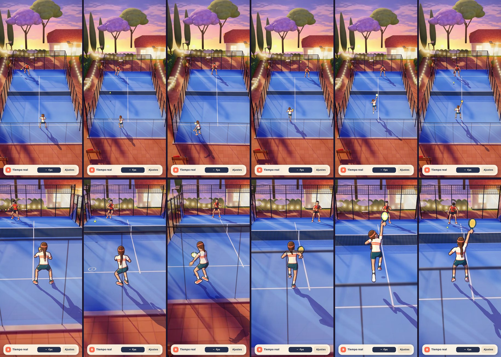

### Autocrítica

Con el criterio de «Exigencia visual» de `CLAUDE.md`. Lo que sigue está mirado en cuadros sueltos y en tiras; **no vi ninguno de estos clips en movimiento continuo**. Los juzgué como un animador juzga una hoja de poses, y eso alcanza para las poses, no para el ritmo.

**Lo que está bien.**

- **La locomoción es el salto más grande.** El trote corto de antes patinaba (los pies recorrían 0,96 m por ciclo y el cuerpo, 1,45). Ahora es una carrera de verdad y los pies quedan clavados.
- **Las poses de los golpes se leen de lejos**: la derecha gira los hombros del todo, el remate es una diagonal larga en el aire, las estiradas son una línea de la punta del pie a la pala.
- **Los cuatro personajes se distinguen de espaldas y de lejos**, por color y por silueta.

**Lo que no está bien.**

- **El ritmo no está probado.** Anticipación lenta, impacto seco y freno están en los tiempos de las claves (entre 0,09 y 0,19 s del final del armado al contacto), pero no pude ver si se sienten así. Es lo primero que hay que mirar en el celular, a velocidad normal y a un cuarto.
- **Todo el elenco se mueve igual.** Tempo y amplitud cambian cuánto y qué tan rápido, no cómo. Beto hace el mismo remate con tijera que Romina, y a los 55 años y con esa panza no debería. Falta un gesto propio por personaje en el armado; `docs/personajes.md` los llama gestos delatores y el motor ya los tiene en su versión gris.
- **El revés es el golpe más flojo.** El cuerpo queda encogido en el impacto y el contacto sale bajo. La volea de revés tapa el torso con la pala.
- **La carrera hacia atrás es correcta y sosa**: los brazos casi no se mueven.
- **El paso lateral tiene el tren superior duro.** Las manos quedan en la posición de espera y solo suben y bajan.
- **Las manos siguen siendo dos.** La izquierda está siempre abierta y la derecha siempre cerrada sobre el mango. No hay puño para festejar ni dedos que señalen.
- **Las caras son correctas y genéricas.** Cuatro expresiones iguales para todos. Los dientes son un rectángulo. De cerca, el borde de la sombra en la mejilla se ve quebrado, porque sigue los polígonos.
- **La dieta se nota de cerca.** Las zapatillas tienen facetas en la puntera y el cuello es un anillo de ocho lados. Las puntas de los dedos son pirámides.
- **Las siluetas son tímidas.** La panza de Beto se ve de costado y casi no de frente. Chela es la misma mujer más chica y con la cabeza más grande: no se le ven los 68 años. Sin arrugas, sin otra forma de pararse, sin otra forma de correr, la edad no aparece.
- **El pelo de Beto y de Chela es el casco de siempre pintado de gris.**
- **La amplitud no se aplica a los golpes** en estas páginas, porque la pala tiene que llegar a la pelota. Cuando el motor corrija el brazo con cinemática inversa, se puede.
- **No hay transiciones entre golpes y carrera.** Todo sale de la espera y vuelve a la espera. Pegar corriendo va a ser una mezcla, no un clip.
- **Faltan golpes del motor**: víbora, contrapared, chiquita y dejada. Hoy se cubren con el más parecido (ver el contrato).

### Pendientes de esta etapa

- **Mirarlos en movimiento en el celular** y ajustar tiempos. Los clips son datos: cambiar un tiempo y volver a exportar tarda 3 segundos.
- **Un gesto propio por personaje** en el armado de los golpes, y una forma propia de correr para Beto y para Chela.
- **Revés y volea de revés**: otra pasada.
- **Pegar en movimiento**: un clip de derecha y uno de revés en carrera, o una capa de piernas debajo del golpe.
- **Más manos**: un puño y un índice que señala, como piezas o como una expresión más.
- **Busto con expresión** para el marcador, usando la vista de cerca.
- **Dobles**: los avisos («¡mía!», «¡tuya!») necesitan un gesto de brazo.

## Contrato para el motor

Todo lo que el motor necesita está en un archivo: [`assets/personaje.bin`](assets/personaje.bin). El lector de referencia es [`lib/personaje.js`](lib/personaje.js): lee el archivo, muestrea los clips, aplica lo propio de cada personaje y dibuja. No depende del resto de la prueba.

### Qué se mantuvo

- **Los mismos 25 huesos**, con los mismos nombres, el mismo orden y las mismas posiciones de reposo.
- **El mismo formato**, `PAD1`. El JSON dice `version: 2`. Todo lo de la versión 1 sigue en su lugar y significa lo mismo; lo nuevo se agrega.
- **Los diez clips de antes conservan su nombre**: `listo`, `correr`, `lateral_izq`, `lateral_der`, `saque`, `derecha`, `reves`, `globo`, `remate` y `festejo`. Cambiaron por dentro: duran distinto y el contacto cae en otro instante. Hay que leer `dur` y `contact` del archivo, no dejarlos fijos en el código.
- **Un lector de la versión 1 abre el archivo nuevo.** Está probado con el código que hoy está en `main`: carga sin errores y dibuja al personaje con trenza, sin caras y sin piezas.

**Lo que cambió y puede romper algo:**

- Dos materiales cambiaron de nombre, no de posición: `shorts_band` pasó a ser `sleeve` y `shoe_tongue`, `sleeve_trim`. Siguen siendo 26 y las paletas se leen por posición, así que un lector que no use los nombres no nota nada.
- La paleta `rival` sigue estando. Las nuevas son `romina`, `beto` y `chela`.
- En `correr`, hacia atrás ya no es el clip al revés: hay `correr_atras`.

### El archivo

```
'PAD1' · largo del JSON (uint32) · JSON · relleno a 4 bytes · bloques binarios
```

Los desplazamientos del JSON son relativos al inicio de los bloques.

| Campo del JSON | Qué es |
| --- | --- |
| `version` | 2 |
| `mesh.nv`, `mesh.pos`, `nrm`, `mat`, `out`, `joints`, `weights` | Vértices, como en la versión 1: posición int16, normal int8, material, ancho de contorno, tres huesos y dos pesos |
| `mesh.idx`, `mesh.nt` | Índices uint16 y cuántos hay en total |
| `mesh.base` | Cuántos índices son del cuerpo base, que se dibuja siempre |
| `mesh.ni` | Cuerpo base más trenza: lo que dibuja un lector de la versión 1 |
| `mesh.piezas` | Piezas opcionales: `nombre`, `inicio` y `cantidad` (en índices) y `vertices`. Van después del cuerpo base, en este orden: `trenza`, `gorra`, `ala`, `bigote` |
| `mesh.morfos` | Caras: `inicio` y `cantidad` (el tramo de vértices que se mueve), `nombres` y `datos` |
| `materials`, `flat`, `palettes` | 26 materiales, cuáles son planos y un color por material en cada paleta |
| `bones` | `names`, `parents` y `rest` |
| `fps` | 30 |
| `caras` | Nombres de las expresiones, con `normal` primero |
| `personajes` | Lo propio de cada personaje |
| `clips` | Los 24 clips, con sus metadatos |

**Piezas.** Para dibujar un personaje: el tramo `[0, base)` y, por cada pieza suya, el tramo `[inicio, inicio + cantidad)`.

**Caras.** `datos` son int16, en la misma escala que las posiciones: `nombres.length × cantidad × 3` valores, una expresión detrás de otra. La posición de un vértice de la cara es la de base más la suma de `peso × diferencia` de cada expresión. Las expresiones no se suman entre sí; el parpadeo sí se suma a la normal.

**Clips.** Como en la versión 1: muestreados a 30 cuadros por segundo. Por cuadro, un cuaternión local por hueso (int16, dividir por 32767) y la posición de la pelvis (int16, dividir por 10000), guardados por componente y como diferencias entre cuadros. El cuadro `f` corresponde al instante `t0 + f / 30`. En los loops, `dur` es exactamente `frames / 30`.

### Datos de cada clip

Todos traen `name`, `dur`, `loop`, `frames`, `t0`, `data`, `label` y `grupo` (`base`, `locomocion`, `golpe`, `reaccion` o `mania`). Distancias en metros, con el personaje a escala 1, en sus propios ejes: mira hacia −y, su derecha es −x y arriba es +z.

**Locomoción**

| Dato | En qué clips | Qué es y cómo se usa |
| --- | --- | --- |
| `zancada` | Los cuatro ciclos | Metros que avanza en un ciclo completo. La fase avanza `distancia / (zancada × escala)` |
| `dir` | Los cuatro ciclos | Hacia dónde avanza: `[0, −1]` adelante, `[0, 1]` atrás, `[1, 0]` a su izquierda, `[−1, 0]` a su derecha |
| `velocidad` | Los cuatro ciclos | `zancada / dur`: la velocidad a la que el clip va a ritmo natural |
| `entrada` | Los cuatro ciclos | Fase en la que conviene entrar viniendo de la espera |
| `apoyos` | Toda la locomoción | Cuándo está apoyado cada pie: `[pie, desde, hasta]`, en segundos del clip. Para el sonido de los pasos o el polvo |
| `raiz` | `arranque`, `frenada` | `dir`, `total` (metros que avanza) y `dist` (metros recorridos en cada cuadro) |
| `enlace` | `arranque`, `frenada` | Con qué fase de `correr` empalma. El arranque termina ahí; la frenada sale de ahí |
| `libre` | `frenada` | Desde este instante ya no avanza: lo que queda se reproduce por tiempo |
| `aterrizaje`, `corte` | `split_step` | Cuándo caen los pies, y desde cuándo se lo puede cortar para salir a moverse |

**Golpes**

| Dato | Qué es y cómo se usa |
| --- | --- |
| `contact` | Instante del impacto, en segundos del clip |
| `cuadro` | **Cuadro de contacto.** Las muestras están alineadas para que el impacto caiga justo en un cuadro, sin interpolar |
| `hit` | Centro de la pala en ese cuadro |
| `mano` | **Posición de la mano en ese cuadro**: la muñeca, que es la articulación del hueso `hand.R` |
| `hombro` | Articulación del hombro derecho en ese cuadro. Con `mano`, da el alcance del brazo |
| `eje` | Hacia dónde apunta la pala, del mango a la cabeza |
| `normal` | Normal de la cara de la pala que pega de derecha. En los reveses apunta hacia atrás |
| `armado` | `[desde, hasta]`: el tramo del armado, que termina en una pausa. **Es lo que se puede estirar** para que el contacto caiga cuando lo pide la simulación. El resto conviene dejarlo a su ritmo |
| `lado` | `derecha` o `reves` |
| `estirada` | `true` en los dos clips para llegar con lo justo |
| `ballHold`, `release` | Solo en `saque`: dónde está la pelota en la mano izquierda al empezar y al soltarla, y cuándo la suelta |

**Todos**

| Dato | Qué es |
| --- | --- |
| `caras` | Tramos con expresión: `[desde, hasta, nombre]` |

### Los 24 clips

| Clip | Grupo | Dura | Contacto | Pala en el contacto (x, y, z) | Notas |
| --- | --- | --- | --- | --- | --- |
| `listo` | base | 1,00 s, loop | | | Espera activa |
| `correr` | locomoción | 0,43 s, loop | | | Zancada 1,80 m |
| `correr_atras` | locomoción | 0,40 s, loop | | | Zancada 1,30 m |
| `lateral_izq` | locomoción | 0,40 s, loop | | | Zancada 1,35 m, hacia su izquierda |
| `lateral_der` | locomoción | 0,40 s, loop | | | Zancada 1,35 m, hacia su derecha |
| `split_step` | locomoción | 0,80 s | | | Cae a los 0,335 s |
| `arranque` | locomoción | 0,30 s | | | Avanza 0,62 m |
| `frenada` | locomoción | 0,47 s | | | Avanza 0,46 m |
| `saque` | golpe | 1,40 s | 0,84 s, cuadro 25 | −0,21 · −0,48 · 0,62 | Suelta la pelota a los 0,20 s |
| `derecha` | golpe | 1,02 s | 0,52 s, cuadro 15 | −0,75 · −0,60 · 0,87 | |
| `reves` | golpe | 1,02 s | 0,52 s, cuadro 15 | 0,43 · −0,75 · 0,91 | |
| `volea` | golpe | 0,66 s | 0,26 s, cuadro 7 | −0,66 · −0,70 · 1,41 | |
| `volea_reves` | golpe | 0,66 s | 0,26 s, cuadro 7 | 0,39 · −0,67 · 1,38 | |
| `bandeja` | golpe | 1,05 s | 0,52 s, cuadro 15 | −0,40 · −0,38 · 2,05 | Sin saltar |
| `remate` | golpe | 1,30 s | 0,62 s, cuadro 18 | −0,30 · −0,52 · 2,42 | Salta |
| `globo` | golpe | 1,08 s | 0,54 s, cuadro 16 | −0,66 · −0,51 · 0,69 | |
| `estirada` | golpe | 0,92 s | 0,36 s, cuadro 10 | −1,35 · −0,32 · 0,59 | Casi sin armado |
| `estirada_reves` | golpe | 0,92 s | 0,36 s, cuadro 10 | 1,34 · −0,47 · 0,58 | Casi sin armado |
| `espera` | reacción | 2,00 s, loop | | | Entre puntos |
| `festejo` | reacción | 0,80 s | | | |
| `lamento` | reacción | 0,80 s | | | |
| `mania_gorra` | manía | 0,46 s | | | Beto |
| `mania_zapatilla` | manía | 0,56 s | | | Romina y el jugador |
| `mania_saludo` | manía | 0,70 s | | | Chela |

### Cómo usarlos

**Moverse.** Elegir el clip por la dirección del movimiento respecto de hacia dónde mira el personaje: hasta 60° de adelante, `correr`; a más de 125°, `correr_atras`; en el medio, el lateral de ese lado. La diferencia con la dirección exacta del clip se resuelve con el giro de pelvis (`P3.twistHips`), con tope en 50°. La fase del ciclo arranca en `entrada` y avanza con la distancia.

**Corridas largas hacia adelante.** `arranque` durante los primeros `raiz.total × escala` metros, con el instante del clip sacado de la tabla `raiz.dist`. Después `correr`, desde la fase de `enlace`. Para frenar, `frenada`, también por la tabla, y desde `libre`, por tiempo. Si la fase de `correr` no coincide con la de `enlace` al empezar a frenar, alcanza con fundir 0,1 s.

**Golpes.** El motor estira el clip para que el contacto coincida con el de la simulación. Lo que mejor aguanta estirarse es el tramo `armado`: se lo puede alargar o sostener en su última pose. Del final del armado al contacto conviene no tocar el ritmo, porque ahí está el golpe seco. En el cuadro `cuadro`, la pala está en `hit`. Para llevarla a la pelota real:

1. Correr `mano` lo mismo que hay de `hit` a la pelota.
2. Resolver el brazo derecho (`upper_arm.R`, `forearm.R`) hacia esa mano. `hombro` es el otro extremo.
3. Dejar el hueso `hand.R` con su giro: así la pala conserva `eje` y `normal`.

Conviene que la corrección entre de a poco desde el final del armado y salga de a poco después del contacto.

**Qué clip para qué golpe del motor.** Elegir por `lado` y por la altura de `hit`:

| Golpe del motor | Clip |
| --- | --- |
| Derecha, salida de pared de derecha | `derecha` |
| Revés, salida de pared de revés | `reves` |
| Volea | `volea` o `volea_reves` |
| Bandeja, víbora | `bandeja` |
| Remate | `remate` |
| Globo | `globo` |
| Chiquita, dejada | `volea` o `volea_reves`, con menos amplitud |
| Pelota a más de un metro del cuerpo | `estirada` o `estirada_reves` |
| Saque | `saque` |
| Contrapared | No hay clip. Hace falta uno de espaldas a la red |

**Split step.** Empezarlo `aterrizaje` segundos antes del contacto del rival. Si hay que salir a moverse, se lo puede cortar desde `corte`.

**Reacciones y manías.** Se reproducen a `tempo` del personaje. Todas salen de la espera y vuelven a la espera, así que se cortan con una mezcla corta.

**Caras.** Mirar los tramos `caras` del clip en curso y llevar el peso de esa expresión a 1, con unos 50 ms de transición. El parpadeo, cada 2 a 5 segundos, dura 0,16 s y no se suma a otra expresión. `P3.makeFace` hace las dos cosas.

### Lo propio de cada personaje

`personajes` tiene una entrada por personaje: `jugador`, `beto`, `romina` y `chela`.

| Dato | Qué es y cómo se usa |
| --- | --- |
| `paleta` | Nombre de su paleta en `palettes` |
| `piezas` | Piezas que lleva |
| `escala` | Tamaño general. Multiplica a la escala con la que el juego dibuja al personaje, y con ella a la zancada y a los puntos de contacto |
| `huesos` | Por hueso, `s` (escala de su parte de la malla, en x, y, z) y `d` (corrimiento de esa parte). La escala también estira la distancia a los huesos hijos. No se hereda de padre a hijo |
| `postura` | Giro extra por hueso, en grados: inclinación hacia adelante, giro a la izquierda y rolido. Se multiplica después del giro del clip |
| `tempo` | Velocidad de sus reacciones y manías |
| `amplitud` | Cuánto exagera el tren superior respecto del primer cuadro de `listo`. 1 lo deja igual |
| `mania` | Su manía, entre los clips |

La matriz de cada hueso es `T(posición) · R · S · T(−reposo)`, más `R · d`. Está en `P3.poseToMatrices`. La postura y la amplitud, en `P3.applyStyle`.

**Con escalas de hueso o postura, la pala no queda exactamente en `hit`.** En Romina se corre 2 o 3 cm. Para el punto exacto hay que calcularlo con las matrices del personaje, como hace `hitOf` en `lib/tiempo-real.js`.

### Lo que el motor tiene y esto no cubre

- **Gestos delatores** (`pointAim`, `plantWide`, `crouchOpenFace`, `stepIn`): no hay clips propios. Se pueden hacer como postura extra sobre el tramo `armado`.
- **Manías que faltan**: silbato, arremangarse, estirar el cuello, anteojos y beso a la pala. Las tres que hay cubren `cap`, `shoeTap` y `wave`; `glasses` puede usar `mania_gorra`.
- **Zurdos**: no hay espejo. Nacho va a necesitar dibujar el modelo espejado.

## La prueba de estilo: cómo verla

De acá en adelante, el documento es el de la prueba de estilo (rondas 1 a 3), con las mediciones al día.

En el celular, con los links de arriba. En la computadora:

```bash
node design/prueba-3d/herramientas/servir.mjs
```

y abrir `http://127.0.0.1:4330/sprites.html` o `http://127.0.0.1:4330/tiempo-real.html`. Hace falta el servidor porque las páginas cargan archivos con `fetch`.

**Interruptores**, iguales en las dos. Arrancan plegados en una barra chica, abajo; se abren con «Ajustes»:

- **Cámara**: cancha entera (fija), o que acompaña al jugador. Las reglas de la segunda están en [La cámara que acompaña](#la-cámara-que-acompaña).
- **Escala** de los personajes: 1,0 (tamaño real), 1,2 – 1,5 según la profundidad (1,2 el jugador cercano y 1,5 el rival; es la que arranca), o 1,7.
- **Reducir movimiento**: deja la cámara fija con la cancha entera y saca los destellos de impacto. Arranca activado si el sistema lo pide.
- **Ver de cerca**: no estaba en el pedido y no es una cámara de juego. Sirve para juzgar el modelo y muestra la diferencia más grande entre los dos caminos.
- **Pausa** y contador: cuadros por segundo y milisegundos de JavaScript por cuadro.

Parámetros de la URL en local: `?escala=0|1|2`, `?camara=fija`, `?reducir=1`, `?cerca=1`, `?t=4.42` (congela ese instante), `?panel=1` (abre los ajustes) y `?ayudas=apuntar` (muestra la marca de objetivo).

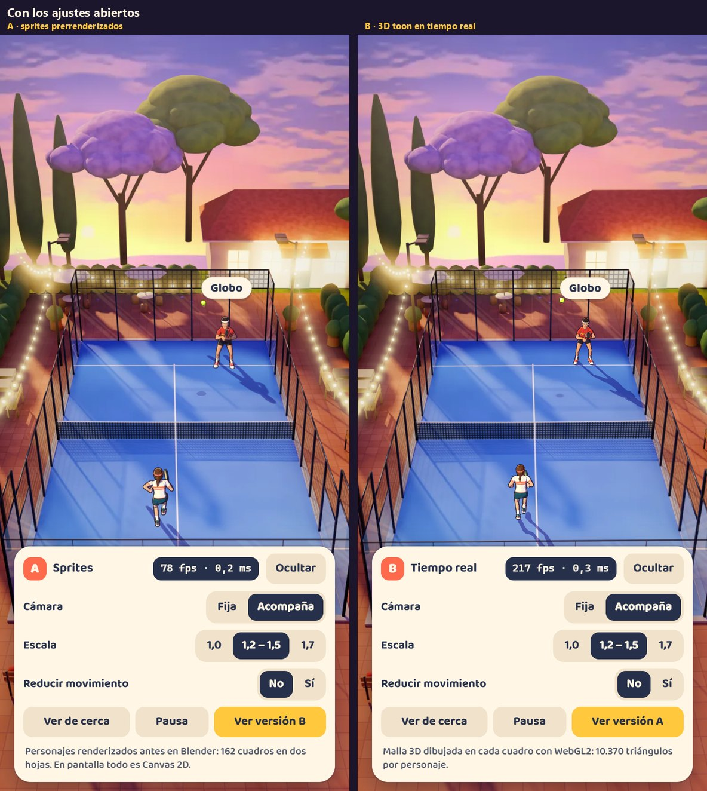

## Qué comparten las dos versiones

### La cancha

Es una escena de Blender renderizada con Cycles **desde la cámara del juego** y guardada en capas. No cuesta nada por cuadro más que copiar imágenes.

- **Luz de verdad**: sol bajo desde atrás y a la izquierda, cielo que rellena las sombras de violeta, rebotes de color, focos apenas encendidos y la luz cálida que sale del buffet.
- **Club**: vereda de baldosas, buffet con techo de tejas y ventanas encendidas, cerco verde, cipreses, un jacarandá en flor (es noviembre) con pétalos caídos, guirnaldas de luces, mesas con sombrilla, bancos con bolsos y macetas.
- **Vidrio**: refleja más cuanto más rasante se lo mira y lleva dos franjas diagonales de brillo por paño. La reja y la red son un velo con grilla ancha, no una trama fina, para que no parpadeen.
- **Revelado**, en `blender/revelar.py`: curva de tonos, bruma hacia el fondo, resplandor del sol, halo de las lamparitas, viñeta y un grano muy fino.
- **Siete capas WebP, 315 KB en total**: cielo, piso, entorno, paredes, red, pared cercana y primer plano. Van separadas porque los personajes se dibujan entre ellas y porque cada una se mueve distinto con la cámara.


Tres decisiones que conviene saber:

1. **El cielo es un telón pintado por código**, no parte de la escena 3D. Con una cámara de juego real, que mira 30° hacia abajo, el horizonte queda fuera de cuadro: es el mismo hallazgo de `docs/graficos-livianos.md`. El telón se ve detrás del cerco y de los árboles. Es un truco de composición, el mismo que usaba la maqueta 2D.
2. **La pared del fondo propio es solo vidrio**, con costuras finas y sin reja arriba, y se dibuja al 70 %. Con la reja completa tapaba al jugador.
3. **Cámara de referencia**: a 16,5 m de alto y 15,9 m detrás del fondo propio, 30° hacia abajo, 56° de campo vertical. La cancha ocupa el 92 % del ancho en el fondo propio y el 52 % en el del rival.

### El personaje

Lo que sigue describe el modelo como estaba en la prueba de estilo. Lo actual (malla más liviana, cuatro personajes, 24 clips y caras) está en [Personajes y animación](#personajes-y-animación). La versión A sigue usando los diez clips de entonces, que quedaron en `blender/animaciones_a.py`.

Un solo modelo, hecho para esta prueba, con dos variantes de color: el jugador propio (crema, coral y verde petróleo) y la rival, que sigue la ficha de Romina de `docs/personajes.md` (rojo, amarillo y negro).

- **Se genera por script** (`blender/personaje.py`). No son primitivas: cada pieza es un tubo con secciones que cambian a lo largo. La pierna tiene 14 secciones, con la rótula, el gemelo y el tobillo.
- **La ropa tapa las uniones**, como en una persona vestida: las piernas entran en el short, los brazos en las mangas y el tobillo en la media.
- **Detalle**: zapatillas con suela, puntera, cordones, lengüeta y cuello acolchado; manos con palma, cuatro dedos y pulgar (la derecha cerrada sobre el mango); cara con cejas, párpado, iris con brillo, nariz, media sonrisa y orejas; vincha, trenza y pala con agujeros.
- **Proporciones**: 6,3 cabezas de alto, piernas largas, manos un 20 % más grandes y zapatillas un 13 % más grandes.
- **Esqueleto** de 25 huesos. Las poses son datos (`blender/animaciones.py`) y piernas y brazos se resuelven con cinemática inversa.
- **Diez clips**: listo, correr, paso lateral a cada lado, saque, derecha, revés, globo, remate y festejo.

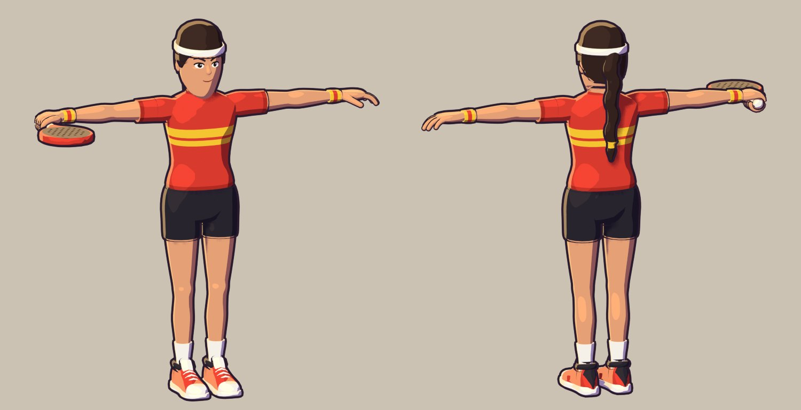


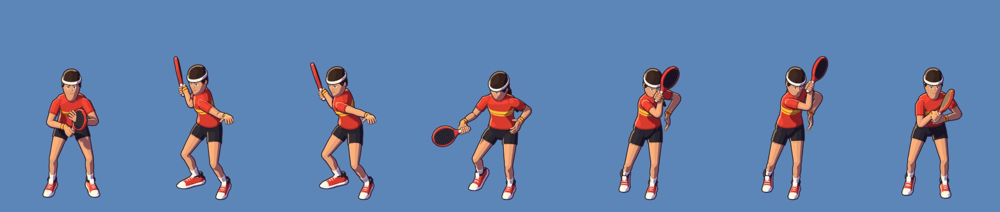

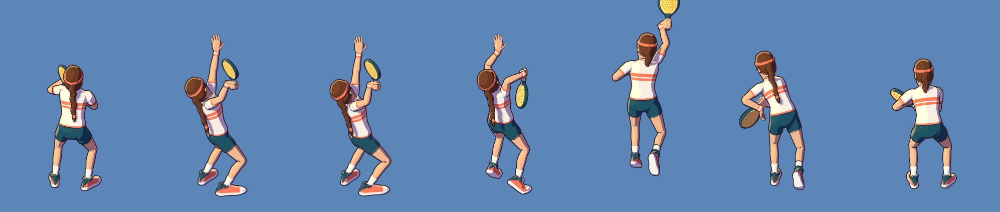

### El peloteo y la interfaz

`lib/base.js` arma el peloteo a partir de una lista de golpes. Hay dos: el de la ronda 1, que usa la versión A, y el nuevo, que usa la B con los clips nuevos (split step, pasos atados a la distancia, arranque y frenada). El punto de impacto sale de la animación (el centro de la pala en ese cuadro, con la escala del personaje) y la pelota vuela en parábolas entre impactos, piques y vidrios. `herramientas/verificar-impactos.mjs` comprueba que en los cinco golpes la pala y la pelota coincidan; hoy el error es cero en los cinco.

La interfaz usa la tipografía y los colores de la maqueta 2D (Baloo 2, crema, tinta y coral).

### La cámara que acompaña

El criterio es del usuario. En tenis la cámara puede pegarse al jugador porque, si la pelota lo pasa, el punto terminó. En pádel no: rebota en el vidrio de atrás y el punto sigue. Por eso la cámara queda en un punto medio entre ver toda la cancha y acercarse, y lo que gana al moverse es que la cancha se siente más grande.

Las seis reglas están en `lib/base.js` (`P3.CAMERA` y `P3.makeFollow`) y valen igual para las dos versiones:

| Regla | Cómo se cumple |
| --- | --- |
| 1. Siempre a la vista, con margen: el jugador propio, la pelota, su marca de pique y el vidrio del fondo propio | En cada cuadro se calcula qué paneo deja esos puntos adentro de sus márgenes. Si con el zoom actual no entran todos, la cámara se abre hasta que entren. El zoom tiene además un tope para que la base del vidrio propio quede arriba de la barra |
| 2. El rival y la red, siempre a la vista | El rival entra en la misma cuenta, con un margen más chico. La red queda adentro por el tope de zoom |
| 3. Paneo lateral y zoom leve, con límites estrictos | El zoom va de 1,00 a 1,30 y no sale de ahí. No hay otro movimiento: la cámara no sube, no baja y no gira más que lo que pide el paneo |
| 4. Se abre con la pelota al fondo propio o con un globo; se cierra con el juego en la red | Tres planos: abierto (1,04), medio (1,16) y de red (1,28). Abre enseguida y cierra con 0,35 s de espera y más despacio |
| 5. Zona muerta y suavizado | El destino del paneo solo se mueve si algo toca su margen o si el encuadre ideal se alejó más de 0,5 m. El movimiento pasa por un resorte sin rebote |
| 6. Con «reducir movimiento», fija con la cancha entera | Es la misma cámara fija del selector |

`herramientas/verificar-camara.mjs` simula tres vueltas del peloteo a 60 cuadros por segundo en cuatro tamaños de pantalla y con las tres escalas, y mide cada regla. En 390 × 844 con la escala del medio:

| Medida | Resultado |
| --- | --- |
| Margen mínimo al borde, en px | jugador 117 · pelota 90 · marca de pique 76 · vidrio propio 57 · rival 100 · red 90 |
| Zoom | de 1,04 a 1,27. Con el globo en el aire, 1,08; con la pelota llegando al vidrio propio, 1,05; con el juego en la red, 1,20 y subiendo |
| Paneo más rápido | 1,5 m/s, con una aceleración máxima de 1,9 m/s² |
| Tiempo con la cámara quieta | 47 % |

Las doce combinaciones cumplen. En una pantalla baja (390 × 700) el tope hace que el zoom llegue solo a 1,21, y el vidrio propio queda justo al borde de la barra.

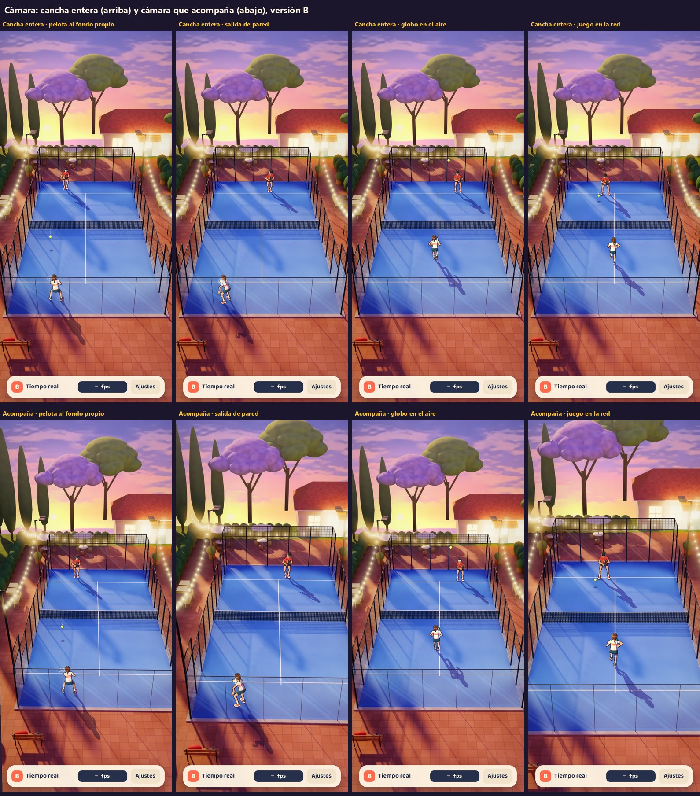

**Cómo la hace cada versión.** La B mueve una cámara 3D: la corre de costado, la gira apenas y cambia la distancia focal. La A imita lo mismo con las capas: zoom, corrimiento e inclinación del plano del piso. En las capturas quietas no se distinguen. En movimiento, la B tiene parallax real entre la red, las paredes y el fondo, y la A solo entre la cancha, el fondo y el cielo.

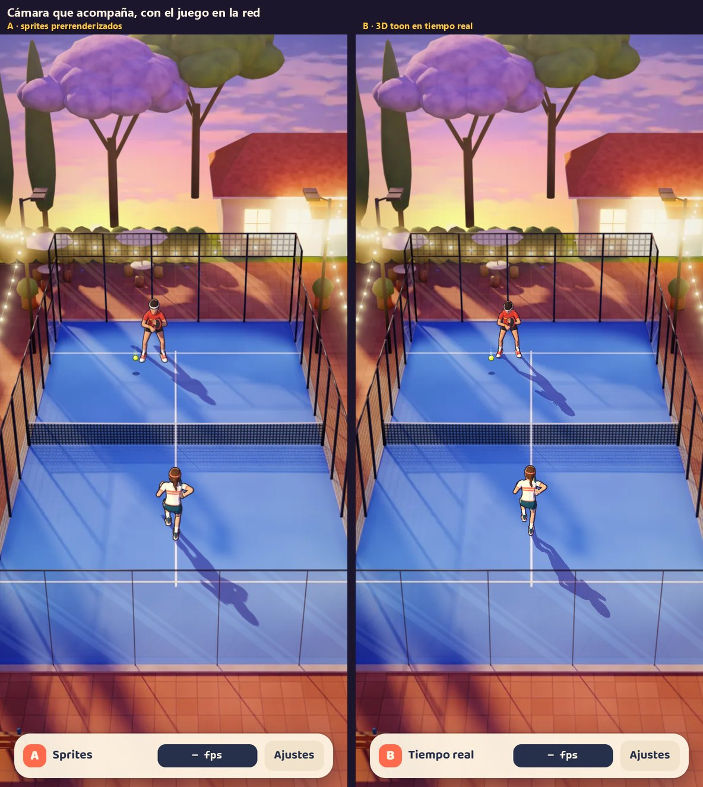

**Lo que falta saber.** Este peloteo está guionado. Las reglas pasan acá, pero falta probarlas con juego real: pelotas que cambian de dirección sin aviso, el jugador pegado a una pared lateral y dobles, donde hay un compañero que también tiene que entrar en cuadro.

### Ayudas en pantalla

Siguen el principio de pantalla limpia: pocas, chicas e integradas en la escena. No hay ningún anillo que marque cuál es el jugador propio, y los anillos de impacto de la primera entrega se sacaron.

| Ayuda | Cuándo aparece | Cómo se ve |
| --- | --- | --- |
| Sombra de la pelota | Siempre | Una mancha oscura justo debajo. Marca la altura: se achica y se aclara cuando la pelota sube |
| Marca de pique | Solo para el primer pique en el lado propio de una pelota que viene del rival | Un anillo fino de medio metro, con un punto, apoyado en el piso |
| Señal de timing | En los últimos 0,18 s antes del golpe propio | La pelota y la pala se encienden con un brillo suave, sin anillos |
| Marca de objetivo | Solo mientras se apunta. Acá no hay control, así que se ve con `?ayudas=apuntar` | El mismo anillo fino, en coral, en el lado del rival |
| Nombre del golpe | Solo en los golpes especiales: «Salida de pared», «Globo» y «¡Remate!». Una derecha o un saque no llevan cartel | Una píldora crema durante 0,85 s sobre quien pega |

Los impactos dejan además un efecto mínimo que no es una ayuda: un destello de cuatro puntas en el golpe, un poco de polvo en el pique y un reflejo en el vidrio. Duran dos décimas y se apagan con «reducir movimiento».

Arriba la versión A y abajo la B. Son la misma lógica dibujada con cada técnica: trazos de Canvas 2D en la A y un shader en la B.

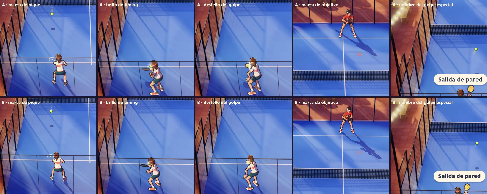

## Cómo está hecha cada versión

### A. Sprites prerrenderizados

- El mismo modelo y las mismas poses se renderizan en Blender con EEVEE, con la luz de la cancha, en dos vistas: el jugador de espaldas visto desde 41° de altura y la rival de frente desde 26°. Son los ángulos con los que la cámara del juego ve a cada uno.
- **162 cuadros en dos hojas** (100 de espaldas y 62 de frente), 619 KB. Los golpes van a 15 cuadros por segundo, con un cuadro que cae justo en el impacto. Los ciclos tienen 7 u 8 cuadros.
- El sombreado lo calcula Blender: tres tonos a partir de una luz real, así que el personaje se hace **sombra a sí mismo** (el brazo sobre el torso, la cabeza sobre los hombros).
- **Sombra en el piso**: la silueta del mismo cuadro, volcada hacia donde cae la luz. Es una aproximación. Sale de la vista de la cámara, no de la del sol.
- **Cámara que acompaña**: paneo, zoom e inclinación del plano del piso. El fondo y el cielo se corren menos y eso da el parallax. Con la cámara fija, el fondo se compone una vez y se reutiliza.

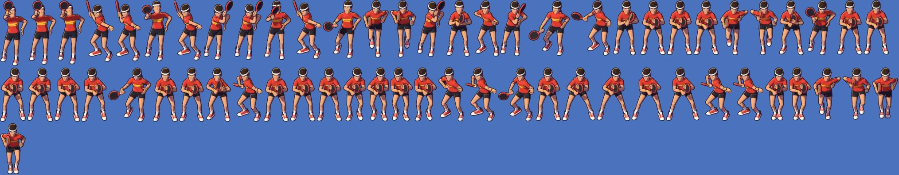

### B. Toon en tiempo real

- **Renderer propio en WebGL2**, sin librerías: `lib/personaje.js`, `lib/gl.js` y `lib/vida.js` pesan 17 KB comprimidos (eran 12,2 KB antes de las caras, las piezas y las escalas de hueso).
- **Personaje**: malla de 4.205 vértices y 5.330 triángulos con esqueleto (7.309 y 10.370 cuando se hizo la prueba). Sombreado toon de tres tonos con la sombra virada al violeta y filo cálido del lado del sol. **Contorno de tinta** por casco invertido, con el mismo ancho que en los sprites. **Sombra proyectada** en el piso con la forma real de la pose.
- Modelo, esqueleto, caras y los 24 clips viajan en un solo archivo de 115 KB comprimido (133 KB con los diez clips de la prueba).
- **Cancha**: las mismas capas, proyectadas desde la cámara de referencia sobre planos del mundo (piso, paredes, red). Con la cámara quieta se ve idéntica al render. Si la cámara se mueve, cada plano se desplaza con la perspectiva que le corresponde.
- **Lo que solo puede hacer esta versión**:
  - Interpola entre cuadros de animación y funde un clip con el siguiente.
  - La cabeza sigue la pelota.
  - La trenza se mueve con resorte.
  - La cámara puede ir a cualquier lado.

## Capturas lado a lado

A la izquierda la A, a la derecha la B, en el mismo instante.


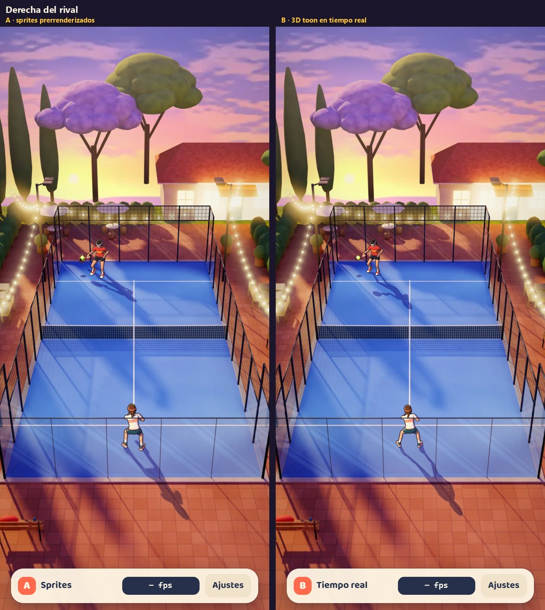


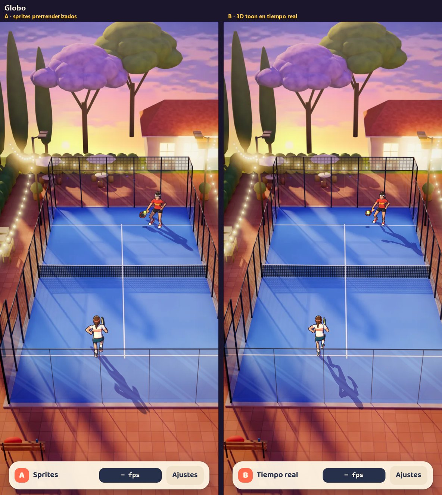


Las tres escalas (la del medio es la de las capturas de arriba):


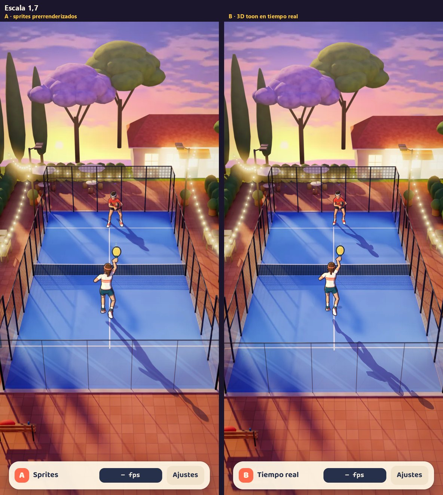

Recortes ampliados al doble, para comparar a los personajes a tamaño de juego:

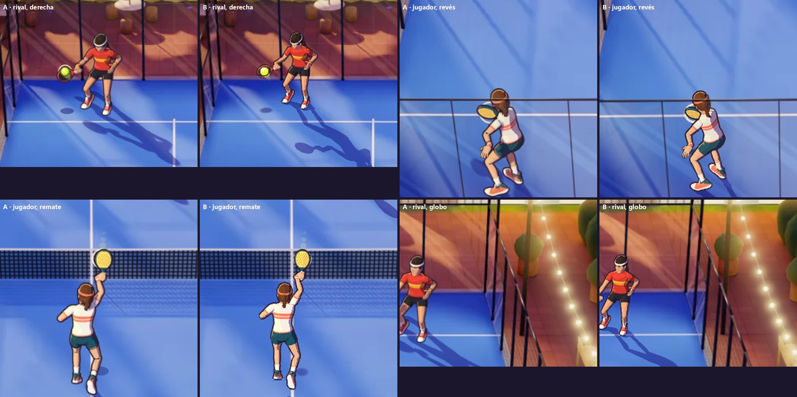

«Ver de cerca». La A solo puede ampliar la imagen. La B mueve la cámara y el personaje sigue nítido:


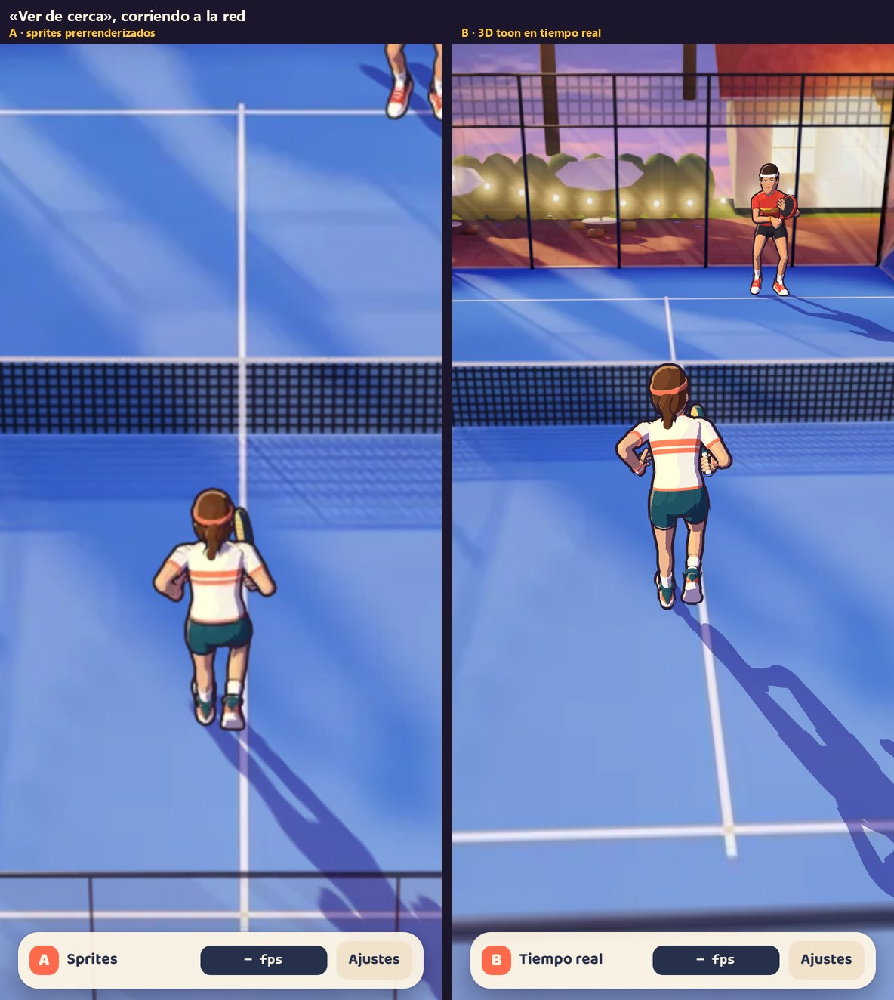

## Comparación

Esta tabla es la que se usó para decidir, con los números de ese momento. Los números al día están en [Mediciones](#mediciones).

| | A. Sprites prerrenderizados | B. Toon en tiempo real |
| --- | --- | --- |
| **Belleza en un cuadro quieto** | Prácticamente igual a la B a tamaño de juego. Tiene sombra propia y bordes suavizados por el render | Prácticamente igual a la A. Le falta la sombra propia (el brazo no oscurece el torso) |
| **Belleza en movimiento** | Golpes a 15 cuadros por segundo y cortes secos entre clips. Nada reacciona a lo que pasa | Movimiento continuo a la tasa de la pantalla, transiciones fundidas, la cabeza mira la pelota y la trenza se mueve |
| **De cerca** | Se ve el píxel: el sprite tiene una resolución fija | Nítido a cualquier distancia |
| **Peso descargado** | 955 KB (619 KB son sprites) | 478 KB (133 KB son modelo y animaciones) |
| **Tiempo hasta el primer cuadro** | 2,1 s con 4G rápido · 8,5 s con 4G lento | 1,4 s con 4G rápido · 4,8 s con 4G lento |
| **JavaScript por cuadro, con CPU 4×** | 0,5 ms | 0,8 ms |
| **GPU** | Sin medir; ver [Mediciones](#mediciones) | 1,2 ms por cuadro en una GPU integrada de PC |
| **Memoria de imágenes** | 24 MB (capas, hojas y siluetas de sombra) | 16 MB (capas con mipmaps y malla) |
| **Otro personaje** | Otra hoja por vista: entre 180 y 430 KB, y memoria en proporción | Si cambia solo el color, 0 KB. Con cuerpo o accesorios propios, unas decenas de KB |
| **Otra animación** | Hay que renderizarla para cada personaje y cada vista. Un golpe de 1 s son 15 cuadros por hoja | Se agrega una vez (2 a 4 KB) y la tienen todos |
| **Golpe a una altura distinta** | Otro juego de cuadros por altura | El mismo clip, corregido con cinemática inversa en vivo (no está hecho en esta prueba) |
| **Cámara móvil** | Paneo, zoom y parallax por capas. Alcanza para la cámara que acompaña tal como está definida (paneo lateral y zoom de hasta 1,30). No cambia el punto de vista | Cualquier cámara. Con la cancha proyectada, hasta un movimiento moderado; para una cámara libre la cancha tendría que ser geometría con luz horneada |
| **Dobles** | Cuatro sprites, pero cada personaje necesita las dos vistas: compañero de espaldas y rival de frente | Cuatro mallas con el mismo archivo. Suma unos 0,5 ms de GPU en la PC de prueba |
| **Compatibilidad** | Canvas 2D: anda en todos lados | WebGL2: 97 % de los navegadores. Necesita un respaldo y manejar la pérdida de contexto |
| **Riesgo** | Bajo en lo técnico. El contenido es rígido y pesa | Medio: drivers y GPU de gama baja sin medir |

### Costo de producción, con más detalle

El modelo, el esqueleto y las poses son los mismos para las dos versiones. Lo que cambia es qué pasa después.

- **En la A, cada combinación se paga**: personaje × vista × clip × cuadro. Esta prueba tiene 2 hojas porque cada personaje se ve desde un solo lado. El elenco de diez personajes, con las dos vistas para dobles, serían 20 hojas y entre 4 y 6 MB. Por partido se cargarían cuatro personajes: entre 1,2 y 2,4 MB. El render es automático (35 segundos las dos hojas de hoy), así que el costo es de descarga y de memoria, no de trabajo humano.
- **En la B, un clip nuevo sirve para todos** y un personaje nuevo es una paleta más las piezas que lo distinguen (panza, gorra, bigote). La variedad de alturas y de zurdos sale de parámetros.
- **Lo que cuesta igual en las dos** es lo que más importa: diseñar cada personaje y animar bien cada golpe.

## Mediciones

Medido con `herramientas/medir.mjs` en Chrome sin ventana, con pantalla de 390 × 844 y DPR 2 emulados, en una PC de escritorio (Ryzen 7 8700G). El resultado completo está en [`medidas.json`](medidas.json). **Los números son de la última corrida**, con el personaje y los clips nuevos en la B. La A no cambió; sus números se mueven una o dos décimas entre corridas.

**La GPU no se emula.** El freno de CPU de las DevTools solo frena JavaScript. El rasterizado corrió en la GPU integrada de esta PC (Radeon 780M), que es bastante más rápida que la de un teléfono. Ningún número de GPU de acá reemplaza la prueba en un teléfono real: para eso está el contador en las dos páginas.

### Peso descargado (comprimido)

| | A | B |
| --- | --- | --- |
| Página y código | 23,6 KB | 37,6 KB |
| Cancha (7 capas WebP y su JSON) | 315,1 KB | 315,1 KB |
| Personajes | 618,8 KB (2 hojas de sprites, 10 clips) | 115,2 KB (malla, esqueleto, caras, 4 personajes y 24 clips) |
| **Total** | **957 KB** | **468 KB** |

- No incluye la tipografía de la interfaz (34 KB, de Google Fonts).
- El código y el binario del modelo viajan con gzip, que es lo que hace el servidor de prueba. El número depende del compresor: los 115 KB del modelo son con el gzip de Node; con brotli serían 83 KB. Falta comprobar si GitHub Pages comprime los `.bin` (ver [Cuánto pesa](#cuánto-pesa)).
- **El Artifact de la B pesa un poco más.** Los Artifacts no sirven archivos binarios genéricos, así que ahí el modelo viaja como texto en base64, que comprimido ocupa alrededor de un 10 % más. En GitHub Pages iría el `.bin`.
- Las dos se pasan del presupuesto orientativo de 300 KB de `docs/investigacion-visual.md`, y la cancha sola ya lo ocupa. Ver [Pendientes](#pendientes).

### Tiempo hasta el primer cuadro

Desde que empieza la navegación hasta que se dibuja el primer cuadro completo.

| | A | B |
| --- | --- | --- |
| Sin límites (red local) | 93 ms | 121 ms |
| CPU 4× | 325 ms | 307 ms |
| CPU 4× y 4G rápido (9 Mbit/s, 165 ms) | 2,2 s | 1,5 s |
| CPU 4× y 4G lento (1,6 Mbit/s, 562 ms) | 8,6 s | 5,1 s |

La diferencia es casi toda descarga. La B compila cuatro shaders chicos y eso no se nota: tarda lo mismo que la A en decodificar sus hojas.

### Trabajo de JavaScript por cuadro

| | A · media | A · p95 | A · máx. | B · media | B · p95 | B · máx. |
| --- | --- | --- | --- | --- | --- | --- |
| Cancha entera, CPU 1× | 0,15 ms | 0,3 | 0,5 | 0,19 ms | 0,3 | 0,6 |
| Cancha entera, CPU 4× | 0,72 ms | 1,3 | 4,7 | 1,09 ms | 1,6 | 4,0 |
| Cámara que acompaña, CPU 1× | 0,13 ms | 0,2 | 0,5 | 0,23 ms | 0,5 | 1,8 |
| Cámara que acompaña, CPU 4× | 0,58 ms | 1,0 | 1,4 | 1,11 ms | 1,9 | 3,8 |

- Las dos usan menos del 15 % del presupuesto de 8 ms por cuadro. El JavaScript no decide entre una y otra.
- **La B subió con los personajes nuevos**: antes hacía entre 0,5 y 0,8 ms con la CPU frenada 4×, y ahora 1,1 ms. Se sumaron la postura y la amplitud de cada personaje, el giro de pelvis, las caras y un peloteo con más lógica. El perfilador no muestra ninguna función que se lleve más del 1 % del cuadro: es la suma de varias cosas chicas. Sin freno son 0,2 ms.
- Entre corridas estos números varían una o dos décimas.

### GPU: lo único que se pudo medir

WebGL2 deja medir cuánto tarda la GPU en un cuadro. Canvas 2D no. Por eso hay número de la B y no de la A.

| Versión B, Radeon 780M integrada | DPR 2 | DPR 3 |
| --- | --- | --- |
| Cámara que acompaña, cuadro completo | 1,19 ms | 2,13 ms |
| Lo mismo sin personajes (solo las capas de la cancha) | 0,81 ms | 1,54 ms |
| Cancha entera (el fondo se dibuja una vez y se copia) | 1,05 ms | 1,65 ms |

- **Más de la mitad del costo son las capas de la cancha**, que las dos versiones dibujan igual. Los dos personajes de malla, con contorno y sombra, suman unos 0,4 a 0,6 ms. La malla nueva tiene la mitad de triángulos y el cuadro completo tarda lo mismo: a este tamaño, el costo de los personajes no está en los triángulos.
- La A hace el mismo trabajo de relleno con las capas y casi nada más. Su costo de GPU tiene que estar cerca de la fila «solo las capas». Es una estimación.
- **En un teléfono**: `docs/graficos-livianos.md` estimó, a partir de un solo dato, que un teléfono de gama media es entre 6 y 20 veces más lento que esta GPU. Con ese factor la B quedaría entre 7 y 24 ms por cuadro y las capas solas entre 4 y 14 ms. El extremo malo no entra en los 16,7 ms de 60 fps. **Por eso hace falta medir en un teléfono real antes de comprometerse**, y por eso la cancha en capas es lo primero a optimizar en cualquiera de los dos caminos.

### Memoria

| | A | B |
| --- | --- | --- |
| Lienzo (780 × 1688) | 5 MB | 5 MB, más el búfer de suavizado de bordes |
| Imágenes decodificadas | 24,4 MB | 16 MB |
| Heap de JavaScript | 1,1 MB | 1,4 MB |

En la A son las capas, las dos hojas y sus siluetas de sombra. En la B son las capas con sus mipmaps y la malla. Las imágenes están calculadas a partir de sus tamaños, no leídas del sistema. En la A la memoria crece con cada personaje (unos 7 MB por hoja de espaldas). En la B no.

## Autocrítica

Mirando piernas, pies, manos, caras y escala contra los favoritos del usuario.

**Piernas.** Se afinan, tienen rodilla (un cambio de perfil y un brillo) y gemelo. Ya no son cilindros. Pero son tímidas:

- De frente el contorno es casi recto. Falta el perfil lateral del gemelo y la rodilla hacia adentro.
- El muslo sigue siendo bastante tubular.
- Al doblar la rodilla más de 90° el volumen se pierde un poco.
- OlliOlli World y Bomb Rush Cyberfunk exageran mucho más: piernas más largas, tobillo más fino, zapatilla más grande. Esto está más cerca de «correcto» que de «con carácter».

**Tobillos.** No se ven: los tapa la media. Se nota que la pierna se afina hacia el pie, que era lo pedido, pero el tobillo como forma no está resuelto.

**Pies.** Es lo mejor del modelo de cerca: suela, puntera, cordones, lengüeta y cuello. A tamaño de juego se leen como zapatilla con suela blanca y puntera clara, que alcanza. Lo que falta: la talonera tiene una forma rara vista de atrás, la suela no tiene dibujo ni separación entre talón y planta, y el pie no se dobla lo suficiente al impulsarse.

**Manos.** Tienen forma: palma, cuatro dedos, pulgar y un puño que agarra el mango. Pero son rígidas. No hay huesos en los dedos, así que la mano libre tiene siempre el mismo gesto, y no hay nudillos. A tamaño de juego miden 3 o 4 px y se leen como «mano», nada más.

**Caras.** Mejor que la maqueta v2: cejas con intención, párpado que corta el ojo, brillo en el iris, nariz, media sonrisa y orejas. Tres límites:

- Hay una sola expresión. No parpadea y no cambia al pegar.
- A tamaño de juego la rival muestra vincha, cejas y ojos como manchas oscuras. Se intuye una cara, no una expresión. Coincide con `docs/referencias-visuales.md`: con la cámara alta, la expresión vive en un busto grande del marcador, no en la cancha.
- El jugador propio está de espaldas y no se le ve la cara.

**Pelo y ropa.** El pelo es un casquete liso con una trenza: correcto y simple, de cerca parece un gorro. La remera y el short no tienen pliegues. Las piezas se cruzan en vez de estar soldadas y se nota en poses extremas, como el hombro al levantar el brazo.

**Escala.** En una pantalla de 390 px de ancho:

| Variante | Jugador cercano | Rival |
| --- | --- | --- |
| 1,0 | 46 px | 34 px |
| 1,2 – 1,5 | 55 px | 51 px |
| 1,7 | 78 px | 58 px |

- La cancha se siente grande y con aire, que era el pedido («todo parece chico en un espacio grande»).
- El costo es que a 1,2 – 1,5 el detalle del personaje casi no se aprecia en el celular: las piernas y los pies que tanto costaron ocupan 20 px.
- **La cámara ve al jugador propio desde 41° de altura** y eso le acorta las piernas un 25 %. Parte de lo que se pierde viene de la cámara, no del modelo.
- Mi lectura: el tamaño correcto está entre la variante del medio y 1,7, o la cámara tiene que bajar un poco.

**Animación.** Las poses tienen anticipación y terminación, y el remate con salto se lee. Lo que falla:

- Los pies patinan al desplazarse. El paso no está ajustado a la velocidad real.
- Correr hacia atrás es el trote al revés.
- No hay paso de ajuste (split step).
- La rival no reacciona al perder el punto.
- En la A los cambios de clip son cortes secos.

**Cancha.** Es lo más logrado. Los puntos flojos:

- El cielo es un telón.
- Los árboles son low-poly simples y el buffet es una caja con techo.
- Los reflejos del vidrio cercano pasan por encima del jugador.
- La sombra de la reja compite un poco con la sombra de la pelota.
- La sombra de la pelota cae recta hacia abajo y las de los personajes siguen al sol. Es una convención de juego (marca la altura), pero es una inconsistencia que se ve.

**Contra los favoritos.** Esto quedó cerca de Racket Club y de Messenger: humanoide simple, toon limpio, club con luz cálida. Está lejos de Rollerdrome o de Bomb Rush Cyberfunk, que tienen una línea con carácter y un diseño de autor. El riesgo de «AI slop» bajó, porque ya no son primitivas y hay luz de verdad, pero no desapareció: el personaje es prolijo y genérico. Le falta una decisión gráfica fuerte y siluetas distintas por personaje. Las dos variantes de hoy solo cambian de color.

**Cámara y ayudas.** Cumplen las reglas en este peloteo, que es siempre el mismo. No es prueba de que funcionen jugando. La marca de pique es tan chica que en un celular puede pasar inadvertida: es lo pedido, pero hay que verlo en la mano. El brillo de timing dura 0,18 s y nadie lo probó como señal para pegar, porque acá no se juega.

**Lo que no se probó.**

- Ningún teléfono real.
- La cámara que acompaña y las ayudas con juego real.
- Safari y Firefox.
- La versión B sin suavizado de bordes.
- Dobles.
- Golpes a distintas alturas.

## Recomendación

**Ir por la B (3D toon en tiempo real), con la cancha horneada en capas como base**, y condicionarlo a una prueba en un Android de gama media.

- **A tamaño de juego las dos se ven casi iguales.** La belleza de un cuadro quieto no decide.
- **Lo que decide es todo lo demás**:
  - La B pesa la mitad y carga en la mitad del tiempo.
  - No crece con cada personaje ni con cada animación, y el elenco tiene diez personajes.
  - Se mueve mejor.
  - Admite la cámara que el usuario imaginó a partir de Tennis Clash.
  - Puede ajustar el golpe a donde realmente está la pelota. En un juego donde el jugador se mueve libre, eso es lo que evita tener un juego de cuadros por cada altura de impacto.
- **El riesgo de la B es la GPU de los teléfonos modestos**, y no se pudo medir acá. Si la prueba en teléfono da mal, lo primero a tocar es la cancha, no los personajes: son más de la mitad del costo. Se puede fundir más capas, bajar la resolución del fondo o apagar el suavizado de bordes.
- **La A queda como respaldo razonable** para equipos sin WebGL2, con pocos personajes. Lo que hay de la A (cámara 2D con parallax, sombras por silueta, las hojas) sirve para eso.

Antes de pulir más el modelo conviene resolver la escala y la altura de la cámara. Hoy son las que más le quitan a piernas y pies.

## Pendientes

- **Medir en un teléfono real** (Android de gama media y un iPhone viejo) con el contador de las páginas.
- **Probar la cámara que acompaña con el motor**: pelotas impredecibles, el jugador contra una pared lateral y dobles. Los límites están juntos en `P3.CAMERA` para ajustarlos.
- **Bajar el peso de la cancha**: probar AVIF, guardar a media resolución las capas blandas (entorno, pared cercana) y fundir piso y paredes cuando la cámara no se mueve.
- ~~Aligerar el modelo~~: hecho en la ronda de personajes. La malla pasó de 7.309 a 4.205 vértices.
- **Sombra propia en la B**, con un mapa de sombras chico.
- **Cinemática inversa en vivo** para llevar la pala a la pelota real. Los datos ya están: cada golpe declara su cuadro de contacto, la mano, el hombro y la orientación de la pala (ver el [contrato](#contrato-para-el-motor)).
- **Bustos con expresión** para el marcador. Las expresiones ya están; falta el encuadre.
- **Dobles**.
- **Un respaldo** para cuando no hay WebGL2.
- **Si la cámara tiene que moverse mucho**, la cancha de la B necesita geometría con luz horneada en lugar de capas proyectadas.

## Cómo se regenera

Todos los assets salen de scripts que están en `blender/`. No hay ningún `.blend` ni ningún paso a mano: el modelo, el esqueleto, las animaciones, la cancha y los renders se vuelven a generar desde cero.

### Un solo comando

```bash
node design/prueba-3d/blender/regenerar.mjs
```

Regenera la cancha y el personaje en un minuto. Para una sola parte:

```bash
node design/prueba-3d/blender/regenerar.mjs cancha
```

```bash
node design/prueba-3d/blender/regenerar.mjs personaje
```

```bash
node design/prueba-3d/blender/regenerar.mjs sprites
```

```bash
node design/prueba-3d/blender/regenerar.mjs revision
```

| Parte | Qué hace | Motor | Tarda |
| --- | --- | --- | --- |
| `cancha` | Renderiza las capas en EXR y las revela a WebP en `assets/cancha/` | Cycles | 50 s |
| `personaje` | Exporta malla, esqueleto, caras, personajes y clips a `assets/personaje.bin`, y verifica que los pies no patinen | No renderiza | 4 s |
| `sprites` | Renderiza las dos vistas y arma las hojas en `assets/sprites/`. `todo` no lo incluye | EEVEE | 26 s |
| `revision` | Hojas para mirar el modelo, los personajes, las caras y todos los clips. No toca los assets | EEVEE | 85 s |

**La versión de sprites quedó congelada.** Sus hojas son las que se renderizaron con el modelo de la ronda 3. Regenerarlas hoy da el modelo actual con los diez clips de la ronda 1 (`animaciones_a.py`): se ve casi igual, pero no es el mismo archivo.

Opciones: `--blender <ruta>`, `--gpu <id>`, `--cycles <nombre>`, `--muestras <n>` y `--conservar` (no borra los temporales). Sin opciones usa el Blender 5.2 instalado en `C:\Program Files\Blender Foundation\Blender 5.2\` y la RX 7800 XT.

### Cómo corre Blender

- **En modo consola** (`-b`), sin abrir la interfaz. No usa ni modifica ninguna sesión de Blender que esté abierta.
- **Siempre con `--factory-startup`**: no lee las preferencias ni los addons del usuario, y no guarda nada en ellos.
- **Con la GPU dedicada.** Esta PC tiene una Radeon 780M integrada, donde está el monitor, y una RX 7800 XT.
  - **EEVEE** dibuja con la GPU de visualización, así que se elige por parámetro: `--gpu-backend vulkan --gpu-device 1002/747e/0`. Sin eso, Blender usaba la 780M con OpenGL. `blender --gpu-backend vulkan --gpu-device help` lista los dispositivos con su identificador.
  - **Cycles** se configura adentro de `cancha.py`: HIP con la placa cuyo nombre contiene «RX 7800 XT» (se cambia con `--cycles` o con la variable `CYCLES_GPU`). Vale solo para esa corrida.
- Cada script informa con qué GPU corrió (`GPU Cycles (HIP): ...`, `GPU EEVEE: VULKAN · ...`).
- Los archivos intermedios van a una carpeta temporal del sistema, con ruta absoluta, que se borra al terminar.

### Los comandos exactos

Esto es lo que ejecuta `regenerar.mjs`, por si hace falta correr un paso suelto. `blender` es `"C:\Program Files\Blender Foundation\Blender 5.2\blender.exe"` y `TMP` es una carpeta temporal cualquiera.

```bash
blender -b --factory-startup --python design/prueba-3d/blender/cancha.py -- TMP/cancha capas 256
```

```bash
blender -b --factory-startup --python design/prueba-3d/blender/revelar.py -- TMP/cancha capas design/prueba-3d/assets/cancha
```

```bash
blender -b --factory-startup --python design/prueba-3d/blender/exportar.py -- design/prueba-3d/assets/personaje.bin
```

```bash
blender -b --factory-startup --gpu-backend vulkan --gpu-device 1002/747e/0 --python design/prueba-3d/blender/render_sprites.py -- TMP/sprites design/prueba-3d/assets/sprites
```

Hojas de revisión sueltas (modelo y clips):

```bash
blender -b --factory-startup --gpu-backend vulkan --gpu-device 1002/747e/0 --python design/prueba-3d/blender/vista.py -- TMP/modelo.png rival 2 todo 20,200
```

```bash
blender -b --factory-startup --gpu-backend vulkan --gpu-device 1002/747e/0 --python design/prueba-3d/blender/vista.py -- TMP/beto.png beto 1 todo 0,35,90,180
```

```bash
blender -b --factory-startup --gpu-backend vulkan --gpu-device 1002/747e/0 --python design/prueba-3d/blender/vista.py -- TMP/alegria.png rival 1 cara 0,30 alegria
```

```bash
blender -b --factory-startup --gpu-backend vulkan --gpu-device 1002/747e/0 --python design/prueba-3d/blender/revisar.py -- TMP remate:lado:9 derecha:juego:9@beto
```

- `vista.py` acepta una paleta (`jugador`, `rival`) o un personaje (`beto`, `romina`, `chela`), que suma sus piezas. La escala de huesos de cada personaje solo se ve en el navegador.
- `revisar.py` hace una tira por trabajo: `clip:vista:cuadros`, con las vistas `juego`, `propio`, `frente`, `espalda`, `lado`, `lado2`, `arriba` y `tres`. Con la variable `HOJA=nombre.png` apila todas las tiras en una imagen, y con `PX=64` las hace al tamaño en que se ven jugando.
- `verificar_pasos.py` mide el patinaje en la fuente, antes de exportar, y avisa si una pierna no llega a su objetivo.
- Para exportar la prueba de estilización: variable `ESTILO=marcado` delante del comando de `exportar.py`.

### Qué tan reproducible es

- **`personaje.bin` sale idéntico**, byte por byte, también con los clips y las caras nuevos.
- **Los renders salen iguales a la vista, no byte por byte.** Entre dos corridas de la cancha la diferencia media es de 0,05 a 0,4 sobre 255 por canal: es ruido del render. Entre los sprites hechos con la 780M y OpenGL y los hechos con la RX 7800 XT y Vulkan, la diferencia media es de 0,7 sobre 255, y la hoja queda con el mismo armado.
- Los assets del repositorio son los que produce el comando de arriba.

### Verificaciones, mediciones y capturas

```bash
node design/prueba-3d/herramientas/verificar-impactos.mjs
```

```bash
node design/prueba-3d/herramientas/verificar-camara.mjs
```

```bash
node design/prueba-3d/herramientas/medir.mjs
```

```bash
node design/prueba-3d/herramientas/capturar.mjs TMP/cap
```

```bash
python design/prueba-3d/herramientas/componer.py TMP/cap design/prueba-3d/capturas
```

```bash
node design/prueba-3d/herramientas/armar-artifact.mjs TMP/artifact
```

Y los de la ronda de personajes:

```bash
node design/prueba-3d/herramientas/verificar-pasos.mjs
```

```bash
node design/prueba-3d/herramientas/pesar.mjs
```

```bash
node design/prueba-3d/herramientas/medir-personajes.mjs
```

```bash
node design/prueba-3d/herramientas/capturar-personajes.mjs TMP/cap "derecha=personaje=beto&clip=derecha&t=0.52"
```

```bash
python design/prueba-3d/herramientas/componer-personajes.py TMP/revision TMP/cap design/prueba-3d/capturas
```

- `verificar-impactos.mjs` comprueba que la pala llegue a la pelota en cada golpe del peloteo.
- `verificar-camara.mjs` comprueba las reglas de la cámara que acompaña, cuadro por cuadro, con los dos peloteos.
- `medir.mjs` escribe `medidas.json`.
- `capturar.mjs` saca capturas sueltas de las dos versiones y `componer.py` las arma lado a lado (necesita Pillow).
- `armar-artifact.mjs` prepara los fragmentos para publicar como Artifact: las dos versiones y la página de personajes.
- `verificar-pasos.mjs` comprueba, sobre el archivo exportado, que los pies no patinen, que los empalmes coincidan y que el contacto de cada golpe esté donde dicen los metadatos.
- `pesar.mjs` dice cuánto pesa cada parte del personaje. Escribe [`pesos.json`](pesos.json) con `--json`.
- `medir-personajes.mjs` mide la página de personajes y el costo de las caras. Escribe [`medidas-personajes.json`](medidas-personajes.json).
- `capturar-personajes.mjs` saca capturas de la página de personajes y `componer-personajes.py` arma las imágenes 30 a 40 de este documento.
- `personaje-node.mjs` carga en Node el mismo lector que usa el navegador. Lo usan las verificaciones.

Los scripts que abren un navegador usan Chrome o Edge sin ventana, con un perfil temporal de ruta absoluta y `--noerrdialogs`, como pide `CLAUDE.md`.

| Carpeta | Qué hay |
| --- | --- |
| `blender/` | `regenerar.mjs` (el comando único), modelo (`comun.py`, `personaje.py`), esqueleto y resolución de poses (`rig.py`), animación (`animbase.py`, `anim_locomocion.py`, `anim_golpes.py`, `anim_gestos.py`, `animaciones.py`; `animaciones_a.py` son los clips de la ronda 1), materiales toon (`toon.py`), cancha (`cancha.py`, `revelar.py`), salidas (`exportar.py`, `render_sprites.py`) y revisión (`vista.py`, `revisar.py`, `verificar_pasos.py`) |
| `lib/` | `base.js` (cámara, capas, peloteos), `ui.js`, `estilo.css`; versión A: `sprites.js`, `sprites-main.js`; versión B: `personaje.js` (el personaje: lectura, poses, estilos, caras y dibujo), `gl.js` (la cancha), `vida.js`, `tiempo-real.js`; página de personajes: `revision.js`, `revision.css` |
| `assets/` | Capas de la cancha, hojas de sprites y `personaje.bin` (malla, esqueleto, caras, personajes y clips) |
| `herramientas/` | Servidor local, capturas, mediciones, verificación y armado de Artifacts |
| `capturas/` | Las imágenes de este documento |

## Assets y licencias

**No hay ningún asset de terceros en el repositorio.**

| Asset | Origen | Licencia |
| --- | --- | --- |
| Personajes: malla, piezas, esqueleto, poses, caras, clips y sprites | Hechos para esta prueba, generados por los scripts de `blender/` | Propio |
| Cancha y club: geometría, materiales, luz y capas | Hecho para esta prueba (`cancha.py`). Texturas por nodos, sin imágenes | Propio |
| Cielo, bruma y resplandor | Pintados por código (`revelar.py`) | Propio |
| Tipografía Baloo 2 | Google Fonts, cargada desde su servidor. No está en el repositorio | SIL Open Font License |

- **Arte conceptual**: se generaron cuatro imágenes de referencia en Google Flow (dos hojas del personaje y dos de la cancha al atardecer). Sirvieron para fijar proporciones, vestuario y clima de luz. No están en el repositorio ni se usaron como textura.
- **Blender**: se usó el Blender 5.2 instalado, siempre en modo consola y con `--factory-startup`. No se tocaron sus preferencias, sus addons ni ninguna escena del usuario, y no se usó el Blender que el usuario tiene abierto.
- No se usó ningún generador de modelos 3D ni ningún modelo de Poly Haven o Poly Pizza.
- Las animaciones no salen de capturas de movimiento ni de ninguna biblioteca: son poses escritas a mano en los scripts.
- Beto, Romina y Chela son personajes del elenco propio del juego (`docs/personajes.md`).
