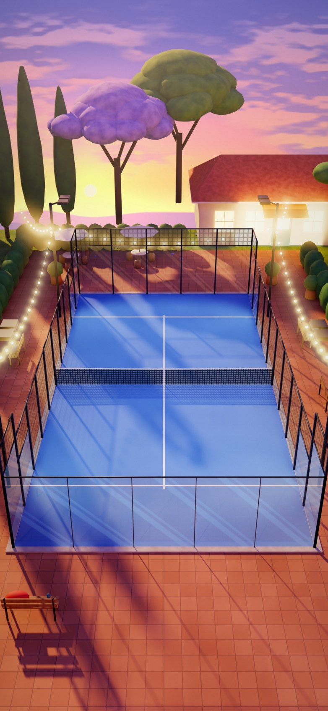
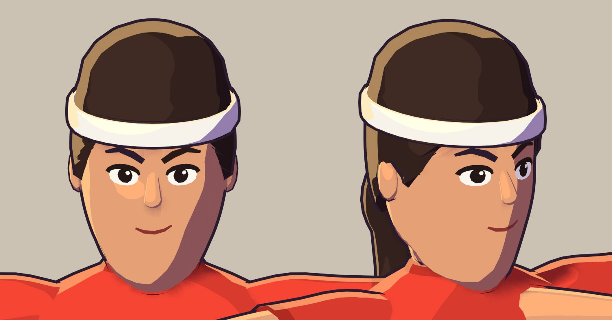
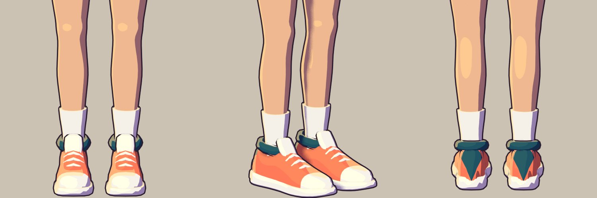
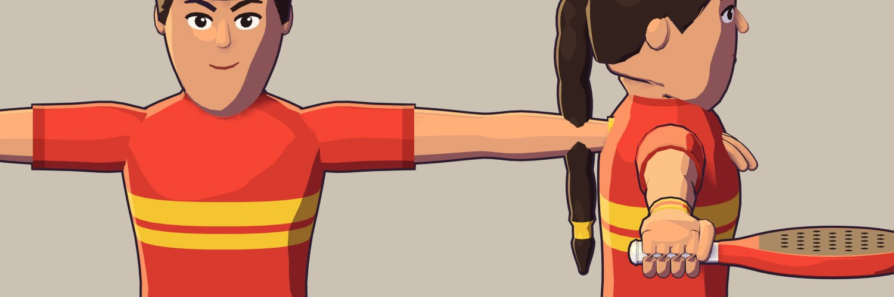
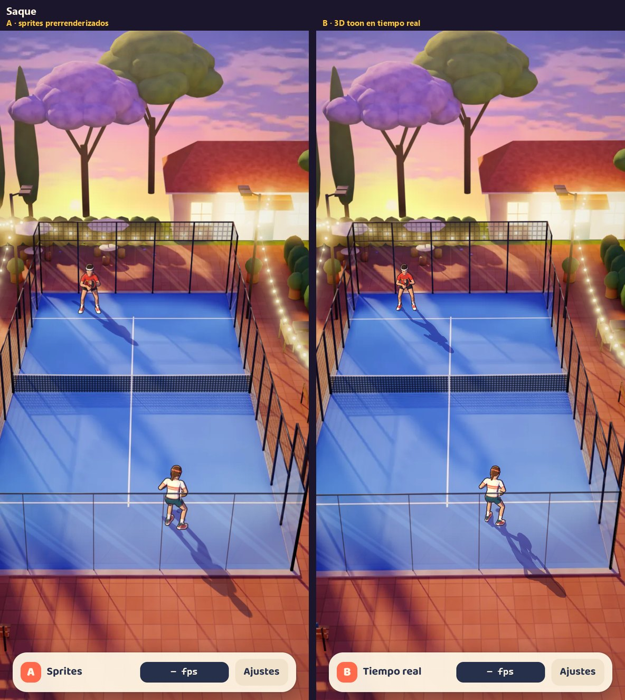
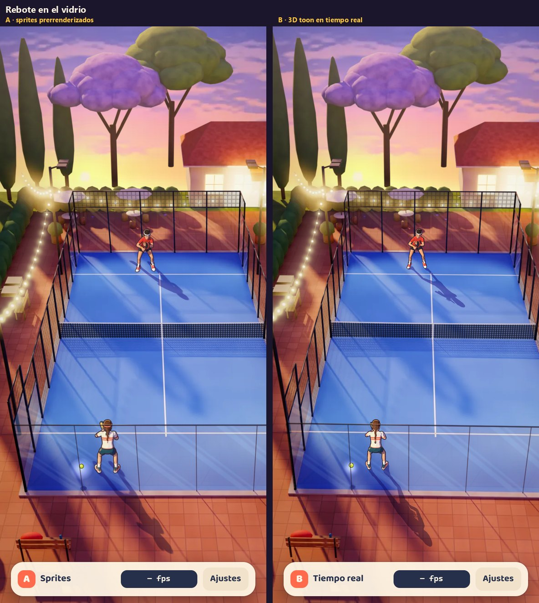
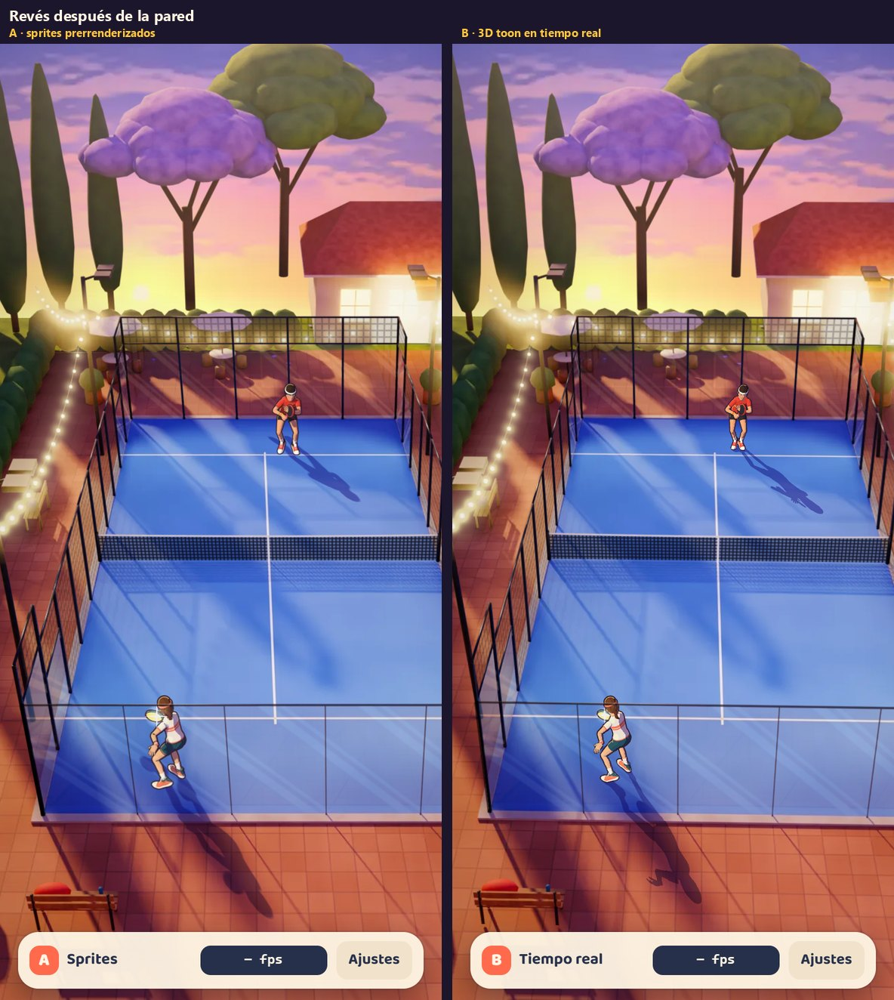
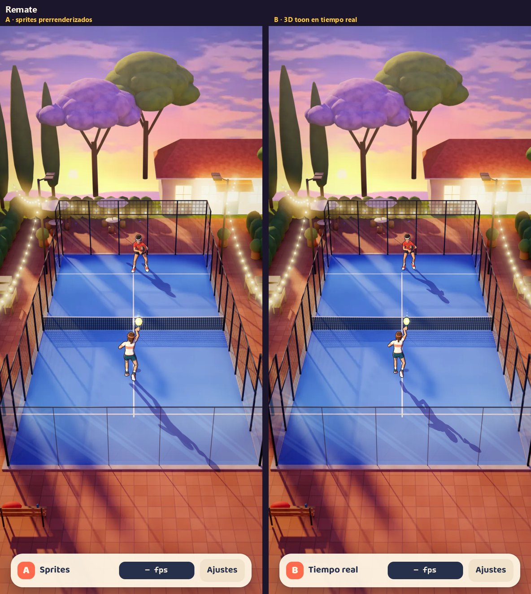
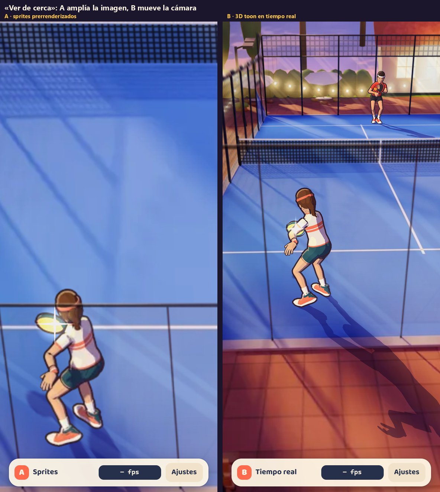

# Prueba 3D: sprites prerrenderizados contra toon en tiempo real

Escena de prueba para decidir el estilo visual entre los dos caminos 3D que quedaron en pie después del tablero de referencias. Las dos versiones muestran **lo mismo**: el mismo peloteo guionado de 11 segundos (saque, derecha del rival, pique y rebote en el vidrio, revés, globo y remate), en vertical, sobre la misma cancha iluminada y con el mismo personaje.

| | Versión | Dónde verla |
| --- | --- | --- |
| **A** | 3D prerrenderizado a sprites. En pantalla todo es Canvas 2D | [`sprites.html`](sprites.html) · [Artifact privado](https://claude.ai/artifact/QhRsg8nWnyou6DNKdaT5ua) |
| **B** | 3D toon en tiempo real, con WebGL2 crudo | [`tiempo-real.html`](tiempo-real.html) · [Artifact privado](https://claude.ai/artifact/7rELuoDGFn3hTNNPiHbtzL) |

Los Artifacts son privados: solo los abre su dueño. Cada uno tiene un botón para pasar al otro.

Este documento tiene, en orden: cómo verla, qué comparten las dos versiones, cómo está hecha cada una, las capturas, la comparación, las mediciones, la autocrítica y la recomendación. Al final, cómo se regenera todo y de dónde sale cada asset.

## Cómo verla

En el celular, con los links de arriba. En la computadora:

```bash
node design/prueba-3d/herramientas/servir.mjs
```

y abrir `http://127.0.0.1:4330/sprites.html` o `http://127.0.0.1:4330/tiempo-real.html`. Hace falta el servidor porque las páginas cargan archivos con `fetch`.

**Interruptores**, iguales en las dos. Arrancan plegados en una barra chica, abajo; se abren con «Ajustes»:

- **Cámara**: cancha entera (fija), o que acompaña al jugador. Las reglas de la segunda están en [La cámara que acompaña](#la-cámara-que-acompaña).
- **Escala** de los personajes: 1,0 (tamaño real), 1,2 – 1,5 según la profundidad (1,2 el jugador cercano y 1,5 el rival; es la que arranca), o 1,7.
- **Reducir movimiento**: deja la cámara fija con la cancha entera y saca los destellos de impacto. Arranca activado si el sistema lo pide.
- **Ver de cerca**: no estaba en el pedido y no es una cámara de juego. Sirve para juzgar el modelo y muestra la diferencia más grande entre los dos caminos.
- **Pausa** y contador: cuadros por segundo y milisegundos de JavaScript por cuadro.

Parámetros de la URL en local: `?escala=0|1|2`, `?camara=fija`, `?reducir=1`, `?cerca=1`, `?t=4.42` (congela ese instante), `?panel=1` (abre los ajustes) y `?ayudas=apuntar` (muestra la marca de objetivo).


## Qué comparten las dos versiones

### La cancha

Es una escena de Blender renderizada con Cycles **desde la cámara del juego** y guardada en capas. No cuesta nada por cuadro más que copiar imágenes.

- **Luz de verdad**: sol bajo desde atrás y a la izquierda, cielo que rellena las sombras de violeta, rebotes de color, focos apenas encendidos y la luz cálida que sale del buffet.
- **Club**: vereda de baldosas, buffet con techo de tejas y ventanas encendidas, cerco verde, cipreses, un jacarandá en flor (es noviembre) con pétalos caídos, guirnaldas de luces, mesas con sombrilla, bancos con bolsos y macetas.
- **Vidrio**: refleja más cuanto más rasante se lo mira y lleva dos franjas diagonales de brillo por paño. La reja y la red son un velo con grilla ancha, no una trama fina, para que no parpadeen.
- **Revelado**, en `blender/revelar.py`: curva de tonos, bruma hacia el fondo, resplandor del sol, halo de las lamparitas, viñeta y un grano muy fino.
- **Siete capas WebP, 315 KB en total**: cielo, piso, entorno, paredes, red, pared cercana y primer plano. Van separadas porque los personajes se dibujan entre ellas y porque cada una se mueve distinto con la cámara.



Tres decisiones que conviene saber:

1. **El cielo es un telón pintado por código**, no parte de la escena 3D. Con una cámara de juego real, que mira 30° hacia abajo, el horizonte queda fuera de cuadro: es el mismo hallazgo de `docs/graficos-livianos.md`. El telón se ve detrás del cerco y de los árboles. Es un truco de composición, el mismo que usaba la maqueta 2D.
2. **La pared del fondo propio es solo vidrio**, con costuras finas y sin reja arriba, y se dibuja al 70 %. Con la reja completa tapaba al jugador.
3. **Cámara de referencia**: a 16,5 m de alto y 15,9 m detrás del fondo propio, 30° hacia abajo, 56° de campo vertical. La cancha ocupa el 92 % del ancho en el fondo propio y el 52 % en el del rival.

### El personaje

Un solo modelo, hecho para esta prueba, con dos variantes de color: el jugador propio (crema, coral y verde petróleo) y la rival, que sigue la ficha de Romina de `docs/personajes.md` (rojo, amarillo y negro).

- **Se genera por script** (`blender/personaje.py`). No son primitivas: cada pieza es un tubo con secciones que cambian a lo largo. La pierna tiene 14 secciones, con la rótula, el gemelo y el tobillo.
- **La ropa tapa las uniones**, como en una persona vestida: las piernas entran en el short, los brazos en las mangas y el tobillo en la media.
- **Detalle**: zapatillas con suela, puntera, cordones, lengüeta y cuello acolchado; manos con palma, cuatro dedos y pulgar (la derecha cerrada sobre el mango); cara con cejas, párpado, iris con brillo, nariz, media sonrisa y orejas; vincha, trenza y pala con agujeros.
- **Proporciones**: 6,3 cabezas de alto, piernas largas, manos un 20 % más grandes y zapatillas un 13 % más grandes.
- **Esqueleto** de 25 huesos. Las poses son datos (`blender/animaciones.py`) y piernas y brazos se resuelven con cinemática inversa.
- **Diez clips**: listo, correr, paso lateral a cada lado, saque, derecha, revés, globo, remate y festejo.









### El peloteo y la interfaz

`lib/base.js` arma el peloteo a partir de una lista de golpes. El punto de impacto sale de la animación (el centro de la pala en ese cuadro, con la escala del personaje) y la pelota vuela en parábolas entre impactos, piques y vidrios. `herramientas/verificar-impactos.mjs` comprueba que en los cinco golpes la pala y la pelota coincidan; hoy el error es cero en los cinco.

La interfaz usa la tipografía y los colores de la maqueta 2D (Baloo 2, crema, tinta y coral).

### La cámara que acompaña

El criterio es del usuario. En tenis la cámara puede pegarse al jugador porque, si la pelota lo pasa, el punto terminó. En pádel no: rebota en el vidrio de atrás y el punto sigue. Por eso la cámara queda en un punto medio entre ver toda la cancha y acercarse, y lo que gana al moverse es que la cancha se siente más grande.

Las seis reglas están en `lib/base.js` (`P3.CAMERA` y `P3.makeFollow`) y valen igual para las dos versiones:

| Regla | Cómo se cumple |
| --- | --- |
| 1. Siempre a la vista, con margen: el jugador propio, la pelota, su marca de pique y el vidrio del fondo propio | En cada cuadro se calcula qué paneo deja esos puntos adentro de sus márgenes. Si con el zoom actual no entran todos, la cámara se abre hasta que entren. El zoom tiene además un tope para que la base del vidrio propio quede arriba de la barra |
| 2. El rival y la red, siempre a la vista | El rival entra en la misma cuenta, con un margen más chico. La red queda adentro por el tope de zoom |
| 3. Paneo lateral y zoom leve, con límites estrictos | El zoom va de 1,00 a 1,30 y no sale de ahí. No hay otro movimiento: la cámara no sube, no baja y no gira más que lo que pide el paneo |
| 4. Se abre con la pelota al fondo propio o con un globo; se cierra con el juego en la red | Tres planos: abierto (1,04), medio (1,16) y de red (1,28). Abre enseguida y cierra con 0,35 s de espera y más despacio |
| 5. Zona muerta y suavizado | El destino del paneo solo se mueve si algo toca su margen o si el encuadre ideal se alejó más de 0,5 m. El movimiento pasa por un resorte sin rebote |
| 6. Con «reducir movimiento», fija con la cancha entera | Es la misma cámara fija del selector |

`herramientas/verificar-camara.mjs` simula tres vueltas del peloteo a 60 cuadros por segundo en cuatro tamaños de pantalla y con las tres escalas, y mide cada regla. En 390 × 844 con la escala del medio:

| Medida | Resultado |
| --- | --- |
| Margen mínimo al borde, en px | jugador 117 · pelota 90 · marca de pique 76 · vidrio propio 57 · rival 100 · red 90 |
| Zoom | de 1,04 a 1,27. Con el globo en el aire, 1,08; con la pelota llegando al vidrio propio, 1,05; con el juego en la red, 1,20 y subiendo |
| Paneo más rápido | 1,5 m/s, con una aceleración máxima de 1,9 m/s² |
| Tiempo con la cámara quieta | 47 % |

Las doce combinaciones cumplen. En una pantalla baja (390 × 700) el tope hace que el zoom llegue solo a 1,21, y el vidrio propio queda justo al borde de la barra.


**Cómo la hace cada versión.** La B mueve una cámara 3D: la corre de costado, la gira apenas y cambia la distancia focal. La A imita lo mismo con las capas: zoom, corrimiento e inclinación del plano del piso. En las capturas quietas no se distinguen. En movimiento, la B tiene parallax real entre la red, las paredes y el fondo, y la A solo entre la cancha, el fondo y el cielo.


**Lo que falta saber.** Este peloteo está guionado. Las reglas pasan acá, pero falta probarlas con juego real: pelotas que cambian de dirección sin aviso, el jugador pegado a una pared lateral y dobles, donde hay un compañero que también tiene que entrar en cuadro.

### Ayudas en pantalla

Siguen el principio de pantalla limpia: pocas, chicas e integradas en la escena. No hay ningún anillo que marque cuál es el jugador propio, y los anillos de impacto de la primera entrega se sacaron.

| Ayuda | Cuándo aparece | Cómo se ve |
| --- | --- | --- |
| Sombra de la pelota | Siempre | Una mancha oscura justo debajo. Marca la altura: se achica y se aclara cuando la pelota sube |
| Marca de pique | Solo para el primer pique en el lado propio de una pelota que viene del rival | Un anillo fino de medio metro, con un punto, apoyado en el piso |
| Señal de timing | En los últimos 0,18 s antes del golpe propio | La pelota y la pala se encienden con un brillo suave, sin anillos |
| Marca de objetivo | Solo mientras se apunta. Acá no hay control, así que se ve con `?ayudas=apuntar` | El mismo anillo fino, en coral, en el lado del rival |
| Nombre del golpe | Solo en los golpes especiales: «Salida de pared», «Globo» y «¡Remate!». Una derecha o un saque no llevan cartel | Una píldora crema durante 0,85 s sobre quien pega |

Los impactos dejan además un efecto mínimo que no es una ayuda: un destello de cuatro puntas en el golpe, un poco de polvo en el pique y un reflejo en el vidrio. Duran dos décimas y se apagan con «reducir movimiento».

Arriba la versión A y abajo la B. Son la misma lógica dibujada con cada técnica: trazos de Canvas 2D en la A y un shader en la B.


## Cómo está hecha cada versión

### A. Sprites prerrenderizados

- El mismo modelo y las mismas poses se renderizan en Blender con EEVEE, con la luz de la cancha, en dos vistas: el jugador de espaldas visto desde 41° de altura y la rival de frente desde 26°. Son los ángulos con los que la cámara del juego ve a cada uno.
- **162 cuadros en dos hojas** (100 de espaldas y 62 de frente), 619 KB. Los golpes van a 15 cuadros por segundo, con un cuadro que cae justo en el impacto. Los ciclos tienen 7 u 8 cuadros.
- El sombreado lo calcula Blender: tres tonos a partir de una luz real, así que el personaje se hace **sombra a sí mismo** (el brazo sobre el torso, la cabeza sobre los hombros).
- **Sombra en el piso**: la silueta del mismo cuadro, volcada hacia donde cae la luz. Es una aproximación. Sale de la vista de la cámara, no de la del sol.
- **Cámara que acompaña**: paneo, zoom e inclinación del plano del piso. El fondo y el cielo se corren menos y eso da el parallax. Con la cámara fija, el fondo se compone una vez y se reutiliza.


### B. Toon en tiempo real

- **Renderer propio en WebGL2**, sin librerías: `lib/gl.js` y `lib/vida.js` pesan 12,2 KB comprimidos.
- **Personaje**: malla de 7.309 vértices y 10.370 triángulos con esqueleto. Sombreado toon de tres tonos con la sombra virada al violeta y filo cálido del lado del sol. **Contorno de tinta** por casco invertido, con el mismo ancho que en los sprites. **Sombra proyectada** en el piso con la forma real de la pose.
- Modelo, esqueleto y los diez clips viajan en un solo archivo de 133 KB comprimido.
- **Cancha**: las mismas capas, proyectadas desde la cámara de referencia sobre planos del mundo (piso, paredes, red). Con la cámara quieta se ve idéntica al render. Si la cámara se mueve, cada plano se desplaza con la perspectiva que le corresponde.
- **Lo que solo puede hacer esta versión**:
  - Interpola entre cuadros de animación y funde un clip con el siguiente.
  - La cabeza sigue la pelota.
  - La trenza se mueve con resorte.
  - La cámara puede ir a cualquier lado.

## Capturas lado a lado

A la izquierda la A, a la derecha la B, en el mismo instante.











Las tres escalas (la del medio es la de las capturas de arriba):


Recortes ampliados al doble, para comparar a los personajes a tamaño de juego:


«Ver de cerca». La A solo puede ampliar la imagen. La B mueve la cámara y el personaje sigue nítido:




## Comparación

| | A. Sprites prerrenderizados | B. Toon en tiempo real |
| --- | --- | --- |
| **Belleza en un cuadro quieto** | Prácticamente igual a la B a tamaño de juego. Tiene sombra propia y bordes suavizados por el render | Prácticamente igual a la A. Le falta la sombra propia (el brazo no oscurece el torso) |
| **Belleza en movimiento** | Golpes a 15 cuadros por segundo y cortes secos entre clips. Nada reacciona a lo que pasa | Movimiento continuo a la tasa de la pantalla, transiciones fundidas, la cabeza mira la pelota y la trenza se mueve |
| **De cerca** | Se ve el píxel: el sprite tiene una resolución fija | Nítido a cualquier distancia |
| **Peso descargado** | 955 KB (619 KB son sprites) | 478 KB (133 KB son modelo y animaciones) |
| **Tiempo hasta el primer cuadro** | 2,1 s con 4G rápido · 8,5 s con 4G lento | 1,4 s con 4G rápido · 4,8 s con 4G lento |
| **JavaScript por cuadro, con CPU 4×** | 0,5 ms | 0,8 ms |
| **GPU** | Sin medir; ver [Mediciones](#mediciones) | 1,2 ms por cuadro en una GPU integrada de PC |
| **Memoria de imágenes** | 24 MB (capas, hojas y siluetas de sombra) | 16 MB (capas con mipmaps y malla) |
| **Otro personaje** | Otra hoja por vista: entre 180 y 430 KB, y memoria en proporción | Si cambia solo el color, 0 KB. Con cuerpo o accesorios propios, unas decenas de KB |
| **Otra animación** | Hay que renderizarla para cada personaje y cada vista. Un golpe de 1 s son 15 cuadros por hoja | Se agrega una vez (2 a 4 KB) y la tienen todos |
| **Golpe a una altura distinta** | Otro juego de cuadros por altura | El mismo clip, corregido con cinemática inversa en vivo (no está hecho en esta prueba) |
| **Cámara móvil** | Paneo, zoom y parallax por capas. Alcanza para la cámara que acompaña tal como está definida (paneo lateral y zoom de hasta 1,30). No cambia el punto de vista | Cualquier cámara. Con la cancha proyectada, hasta un movimiento moderado; para una cámara libre la cancha tendría que ser geometría con luz horneada |
| **Dobles** | Cuatro sprites, pero cada personaje necesita las dos vistas: compañero de espaldas y rival de frente | Cuatro mallas con el mismo archivo. Suma unos 0,5 ms de GPU en la PC de prueba |
| **Compatibilidad** | Canvas 2D: anda en todos lados | WebGL2: 97 % de los navegadores. Necesita un respaldo y manejar la pérdida de contexto |
| **Riesgo** | Bajo en lo técnico. El contenido es rígido y pesa | Medio: drivers y GPU de gama baja sin medir |

### Costo de producción, con más detalle

El modelo, el esqueleto y las poses son los mismos para las dos versiones. Lo que cambia es qué pasa después.

- **En la A, cada combinación se paga**: personaje × vista × clip × cuadro. Esta prueba tiene 2 hojas porque cada personaje se ve desde un solo lado. El elenco de diez personajes, con las dos vistas para dobles, serían 20 hojas y entre 4 y 6 MB. Por partido se cargarían cuatro personajes: entre 1,2 y 2,4 MB. El render es automático (35 segundos las dos hojas de hoy), así que el costo es de descarga y de memoria, no de trabajo humano.
- **En la B, un clip nuevo sirve para todos** y un personaje nuevo es una paleta más las piezas que lo distinguen (panza, gorra, bigote). La variedad de alturas y de zurdos sale de parámetros.
- **Lo que cuesta igual en las dos** es lo que más importa: diseñar cada personaje y animar bien cada golpe.

## Mediciones

Medido con `herramientas/medir.mjs` en Chrome sin ventana, con pantalla de 390 × 844 y DPR 2 emulados, en una PC de escritorio (Ryzen 7 8700G). El resultado completo está en [`medidas.json`](medidas.json).

**La GPU no se emula.** El freno de CPU de las DevTools solo frena JavaScript. El rasterizado corrió en la GPU integrada de esta PC (Radeon 780M), que es bastante más rápida que la de un teléfono. Ningún número de GPU de acá reemplaza la prueba en un teléfono real: para eso está el contador en las dos páginas.

### Peso descargado (comprimido)

| | A | B |
| --- | --- | --- |
| Página y código | 21,4 KB | 30,1 KB |
| Cancha (7 capas WebP y su JSON) | 315,2 KB | 315,2 KB |
| Personajes | 618,8 KB (2 hojas de sprites) | 132,6 KB (malla, esqueleto y 10 clips) |
| **Total** | **955 KB** | **478 KB** |

- No incluye la tipografía de la interfaz (34 KB, de Google Fonts).
- El código y el binario del modelo viajan con gzip, que es lo que haría GitHub Pages. El número depende del compresor: los 132,6 KB del modelo son con el gzip de Node; con brotli serían 88 KB.
- **El Artifact de la B pesa un poco más.** Los Artifacts no sirven archivos binarios genéricos, así que ahí el modelo viaja como texto en base64, que comprimido ocupa alrededor de un 10 % más. En GitHub Pages iría el `.bin`.
- Las dos se pasan del presupuesto orientativo de 300 KB de `docs/investigacion-visual.md`, y la cancha sola ya lo ocupa. Ver [Pendientes](#pendientes).

### Tiempo hasta el primer cuadro

Desde que empieza la navegación hasta que se dibuja el primer cuadro completo.

| | A | B |
| --- | --- | --- |
| Sin límites (red local) | 86 ms | 111 ms |
| CPU 4× | 268 ms | 293 ms |
| CPU 4× y 4G rápido (9 Mbit/s, 165 ms) | 2,1 s | 1,4 s |
| CPU 4× y 4G lento (1,6 Mbit/s, 562 ms) | 8,5 s | 4,8 s |

La diferencia es casi toda descarga. La B compila cuatro shaders chicos y eso no se nota: tarda lo mismo que la A en decodificar sus hojas.

### Trabajo de JavaScript por cuadro

| | A · media | A · p95 | A · máx. | B · media | B · p95 | B · máx. |
| --- | --- | --- | --- | --- | --- | --- |
| Cancha entera, CPU 1× | 0,13 ms | 0,2 | 0,4 | 0,16 ms | 0,3 | 0,5 |
| Cancha entera, CPU 4× | 0,61 ms | 1,0 | 1,9 | 0,54 ms | 0,8 | 3,7 |
| Cámara que acompaña, CPU 1× | 0,15 ms | 0,3 | 0,5 | 0,16 ms | 0,3 | 0,4 |
| Cámara que acompaña, CPU 4× | 0,49 ms | 0,8 | 1,5 | 0,80 ms | 1,4 | 3,1 |

Las dos usan alrededor del 10 % del presupuesto de 8 ms por cuadro, o menos. El JavaScript no decide entre una y otra. Entre corridas estos números varían una o dos décimas.

### GPU: lo único que se pudo medir

WebGL2 deja medir cuánto tarda la GPU en un cuadro. Canvas 2D no. Por eso hay número de la B y no de la A.

| Versión B, Radeon 780M integrada | DPR 2 | DPR 3 |
| --- | --- | --- |
| Cámara que acompaña, cuadro completo | 1,19 ms | 2,01 ms |
| Lo mismo sin personajes (solo las capas de la cancha) | 0,69 ms | 1,56 ms |
| Cancha entera (el fondo se dibuja una vez y se copia) | 0,98 ms | 1,79 ms |

- **Más de la mitad del costo son las capas de la cancha**, que las dos versiones dibujan igual. Los dos personajes de malla, con contorno y sombra, suman unos 0,5 ms.
- La A hace el mismo trabajo de relleno con las capas y casi nada más. Su costo de GPU tiene que estar cerca de la fila «solo las capas». Es una estimación.
- **En un teléfono**: `docs/graficos-livianos.md` estimó, a partir de un solo dato, que un teléfono de gama media es entre 6 y 20 veces más lento que esta GPU. Con ese factor la B quedaría entre 7 y 24 ms por cuadro y las capas solas entre 4 y 14 ms. El extremo malo no entra en los 16,7 ms de 60 fps. **Por eso hace falta medir en un teléfono real antes de comprometerse**, y por eso la cancha en capas es lo primero a optimizar en cualquiera de los dos caminos.

### Memoria

| | A | B |
| --- | --- | --- |
| Lienzo (780 × 1688) | 5 MB | 5 MB, más el búfer de suavizado de bordes |
| Imágenes decodificadas | 24,4 MB | 16 MB |
| Heap de JavaScript | 1,1 MB | 1,1 MB |

En la A son las capas, las dos hojas y sus siluetas de sombra. En la B son las capas con sus mipmaps y la malla. Las imágenes están calculadas a partir de sus tamaños, no leídas del sistema. En la A la memoria crece con cada personaje (unos 7 MB por hoja de espaldas). En la B no.

## Autocrítica

Mirando piernas, pies, manos, caras y escala contra los favoritos del usuario.

**Piernas.** Se afinan, tienen rodilla (un cambio de perfil y un brillo) y gemelo. Ya no son cilindros. Pero son tímidas:

- De frente el contorno es casi recto. Falta el perfil lateral del gemelo y la rodilla hacia adentro.
- El muslo sigue siendo bastante tubular.
- Al doblar la rodilla más de 90° el volumen se pierde un poco.
- OlliOlli World y Bomb Rush Cyberfunk exageran mucho más: piernas más largas, tobillo más fino, zapatilla más grande. Esto está más cerca de «correcto» que de «con carácter».

**Tobillos.** No se ven: los tapa la media. Se nota que la pierna se afina hacia el pie, que era lo pedido, pero el tobillo como forma no está resuelto.

**Pies.** Es lo mejor del modelo de cerca: suela, puntera, cordones, lengüeta y cuello. A tamaño de juego se leen como zapatilla con suela blanca y puntera clara, que alcanza. Lo que falta: la talonera tiene una forma rara vista de atrás, la suela no tiene dibujo ni separación entre talón y planta, y el pie no se dobla lo suficiente al impulsarse.

**Manos.** Tienen forma: palma, cuatro dedos, pulgar y un puño que agarra el mango. Pero son rígidas. No hay huesos en los dedos, así que la mano libre tiene siempre el mismo gesto, y no hay nudillos. A tamaño de juego miden 3 o 4 px y se leen como «mano», nada más.

**Caras.** Mejor que la maqueta v2: cejas con intención, párpado que corta el ojo, brillo en el iris, nariz, media sonrisa y orejas. Tres límites:

- Hay una sola expresión. No parpadea y no cambia al pegar.
- A tamaño de juego la rival muestra vincha, cejas y ojos como manchas oscuras. Se intuye una cara, no una expresión. Coincide con `docs/referencias-visuales.md`: con la cámara alta, la expresión vive en un busto grande del marcador, no en la cancha.
- El jugador propio está de espaldas y no se le ve la cara.

**Pelo y ropa.** El pelo es un casquete liso con una trenza: correcto y simple, de cerca parece un gorro. La remera y el short no tienen pliegues. Las piezas se cruzan en vez de estar soldadas y se nota en poses extremas, como el hombro al levantar el brazo.

**Escala.** En una pantalla de 390 px de ancho:

| Variante | Jugador cercano | Rival |
| --- | --- | --- |
| 1,0 | 46 px | 34 px |
| 1,2 – 1,5 | 55 px | 51 px |
| 1,7 | 78 px | 58 px |

- La cancha se siente grande y con aire, que era el pedido («todo parece chico en un espacio grande»).
- El costo es que a 1,2 – 1,5 el detalle del personaje casi no se aprecia en el celular: las piernas y los pies que tanto costaron ocupan 20 px.
- **La cámara ve al jugador propio desde 41° de altura** y eso le acorta las piernas un 25 %. Parte de lo que se pierde viene de la cámara, no del modelo.
- Mi lectura: el tamaño correcto está entre la variante del medio y 1,7, o la cámara tiene que bajar un poco.

**Animación.** Las poses tienen anticipación y terminación, y el remate con salto se lee. Lo que falla:

- Los pies patinan al desplazarse. El paso no está ajustado a la velocidad real.
- Correr hacia atrás es el trote al revés.
- No hay paso de ajuste (split step).
- La rival no reacciona al perder el punto.
- En la A los cambios de clip son cortes secos.

**Cancha.** Es lo más logrado. Los puntos flojos:

- El cielo es un telón.
- Los árboles son low-poly simples y el buffet es una caja con techo.
- Los reflejos del vidrio cercano pasan por encima del jugador.
- La sombra de la reja compite un poco con la sombra de la pelota.
- La sombra de la pelota cae recta hacia abajo y las de los personajes siguen al sol. Es una convención de juego (marca la altura), pero es una inconsistencia que se ve.

**Contra los favoritos.** Esto quedó cerca de Racket Club y de Messenger: humanoide simple, toon limpio, club con luz cálida. Está lejos de Rollerdrome o de Bomb Rush Cyberfunk, que tienen una línea con carácter y un diseño de autor. El riesgo de «AI slop» bajó, porque ya no son primitivas y hay luz de verdad, pero no desapareció: el personaje es prolijo y genérico. Le falta una decisión gráfica fuerte y siluetas distintas por personaje. Las dos variantes de hoy solo cambian de color.

**Cámara y ayudas.** Cumplen las reglas en este peloteo, que es siempre el mismo. No es prueba de que funcionen jugando. La marca de pique es tan chica que en un celular puede pasar inadvertida: es lo pedido, pero hay que verlo en la mano. El brillo de timing dura 0,18 s y nadie lo probó como señal para pegar, porque acá no se juega.

**Lo que no se probó.**

- Ningún teléfono real.
- La cámara que acompaña y las ayudas con juego real.
- Safari y Firefox.
- La versión B sin suavizado de bordes.
- Dobles.
- Golpes a distintas alturas.

## Recomendación

**Ir por la B (3D toon en tiempo real), con la cancha horneada en capas como base**, y condicionarlo a una prueba en un Android de gama media.

- **A tamaño de juego las dos se ven casi iguales.** La belleza de un cuadro quieto no decide.
- **Lo que decide es todo lo demás**:
  - La B pesa la mitad y carga en la mitad del tiempo.
  - No crece con cada personaje ni con cada animación, y el elenco tiene diez personajes.
  - Se mueve mejor.
  - Admite la cámara que el usuario imaginó a partir de Tennis Clash.
  - Puede ajustar el golpe a donde realmente está la pelota. En un juego donde el jugador se mueve libre, eso es lo que evita tener un juego de cuadros por cada altura de impacto.
- **El riesgo de la B es la GPU de los teléfonos modestos**, y no se pudo medir acá. Si la prueba en teléfono da mal, lo primero a tocar es la cancha, no los personajes: son más de la mitad del costo. Se puede fundir más capas, bajar la resolución del fondo o apagar el suavizado de bordes.
- **La A queda como respaldo razonable** para equipos sin WebGL2, con pocos personajes. Lo que hay de la A (cámara 2D con parallax, sombras por silueta, las hojas) sirve para eso.

Antes de pulir más el modelo conviene resolver la escala y la altura de la cámara. Hoy son las que más le quitan a piernas y pies.

## Pendientes

- **Medir en un teléfono real** (Android de gama media y un iPhone viejo) con el contador de las páginas.
- **Probar la cámara que acompaña con el motor**: pelotas impredecibles, el jugador contra una pared lateral y dobles. Los límites están juntos en `P3.CAMERA` para ajustarlos.
- **Bajar el peso de la cancha**: probar AVIF, guardar a media resolución las capas blandas (entorno, pared cercana) y fundir piso y paredes cuando la cámara no se mueve.
- **Aligerar el modelo**: la malla tiene vértices de sobra en zapatillas, dedos y agujeros de la pala.
- **Sombra propia en la B**, con un mapa de sombras chico.
- **Cinemática inversa en vivo** para llevar la pala a la pelota real. Los datos ya están: la pose es un esqueleto con huesos.
- **Bustos con expresión** para el marcador.
- **Dobles**.
- **Un respaldo** para cuando no hay WebGL2.
- **Si la cámara tiene que moverse mucho**, la cancha de la B necesita geometría con luz horneada en lugar de capas proyectadas.

## Cómo se regenera

Todos los assets salen de scripts que están en `blender/`. No hay ningún `.blend` ni ningún paso a mano: el modelo, el esqueleto, las animaciones, la cancha y los renders se vuelven a generar desde cero.

### Un solo comando

```bash
node design/prueba-3d/blender/regenerar.mjs
```

Regenera todo en un minuto y medio. Para una sola parte:

```bash
node design/prueba-3d/blender/regenerar.mjs cancha
```

```bash
node design/prueba-3d/blender/regenerar.mjs personaje
```

```bash
node design/prueba-3d/blender/regenerar.mjs sprites
```

```bash
node design/prueba-3d/blender/regenerar.mjs revision
```

| Parte | Qué hace | Motor | Tarda |
| --- | --- | --- | --- |
| `cancha` | Renderiza las capas en EXR y las revela a WebP en `assets/cancha/` | Cycles | 50 s |
| `personaje` | Exporta malla, esqueleto y clips a `assets/personaje.bin` | No renderiza | 2 s |
| `sprites` | Renderiza las dos vistas y arma las hojas en `assets/sprites/` | EEVEE | 26 s |
| `revision` | Hojas para mirar el modelo y los clips. No toca los assets | EEVEE | 37 s |

Opciones: `--blender <ruta>`, `--gpu <id>`, `--cycles <nombre>`, `--muestras <n>` y `--conservar` (no borra los temporales). Sin opciones usa el Blender 5.2 instalado en `C:\Program Files\Blender Foundation\Blender 5.2\` y la RX 7800 XT.

### Cómo corre Blender

- **En modo consola** (`-b`), sin abrir la interfaz. No usa ni modifica ninguna sesión de Blender que esté abierta.
- **Siempre con `--factory-startup`**: no lee las preferencias ni los addons del usuario, y no guarda nada en ellos.
- **Con la GPU dedicada.** Esta PC tiene una Radeon 780M integrada, donde está el monitor, y una RX 7800 XT.
  - **EEVEE** dibuja con la GPU de visualización, así que se elige por parámetro: `--gpu-backend vulkan --gpu-device 1002/747e/0`. Sin eso, Blender usaba la 780M con OpenGL. `blender --gpu-backend vulkan --gpu-device help` lista los dispositivos con su identificador.
  - **Cycles** se configura adentro de `cancha.py`: HIP con la placa cuyo nombre contiene «RX 7800 XT» (se cambia con `--cycles` o con la variable `CYCLES_GPU`). Vale solo para esa corrida.
- Cada script informa con qué GPU corrió (`GPU Cycles (HIP): ...`, `GPU EEVEE: VULKAN · ...`).
- Los archivos intermedios van a una carpeta temporal del sistema, con ruta absoluta, que se borra al terminar.

### Los comandos exactos

Esto es lo que ejecuta `regenerar.mjs`, por si hace falta correr un paso suelto. `blender` es `"C:\Program Files\Blender Foundation\Blender 5.2\blender.exe"` y `TMP` es una carpeta temporal cualquiera.

```bash
blender -b --factory-startup --python design/prueba-3d/blender/cancha.py -- TMP/cancha capas 256
```

```bash
blender -b --factory-startup --python design/prueba-3d/blender/revelar.py -- TMP/cancha capas design/prueba-3d/assets/cancha
```

```bash
blender -b --factory-startup --python design/prueba-3d/blender/exportar.py -- design/prueba-3d/assets/personaje.bin
```

```bash
blender -b --factory-startup --gpu-backend vulkan --gpu-device 1002/747e/0 --python design/prueba-3d/blender/render_sprites.py -- TMP/sprites design/prueba-3d/assets/sprites
```

Hojas de revisión sueltas (modelo y clips):

```bash
blender -b --factory-startup --gpu-backend vulkan --gpu-device 1002/747e/0 --python design/prueba-3d/blender/vista.py -- TMP/modelo.png rival 2 todo 20,200
```

```bash
blender -b --factory-startup --gpu-backend vulkan --gpu-device 1002/747e/0 --python design/prueba-3d/blender/vista_anim.py -- TMP/remate.png remate espalda 7 jugador
```

### Qué tan reproducible es

- **`personaje.bin` sale idéntico**, byte por byte.
- **Los renders salen iguales a la vista, no byte por byte.** Entre dos corridas de la cancha la diferencia media es de 0,05 a 0,4 sobre 255 por canal: es ruido del render. Entre los sprites hechos con la 780M y OpenGL y los hechos con la RX 7800 XT y Vulkan, la diferencia media es de 0,7 sobre 255, y la hoja queda con el mismo armado.
- Los assets del repositorio son los que produce el comando de arriba.

### Verificaciones, mediciones y capturas

```bash
node design/prueba-3d/herramientas/verificar-impactos.mjs
```

```bash
node design/prueba-3d/herramientas/verificar-camara.mjs
```

```bash
node design/prueba-3d/herramientas/medir.mjs
```

```bash
node design/prueba-3d/herramientas/capturar.mjs TMP/cap
```

```bash
python design/prueba-3d/herramientas/componer.py TMP/cap design/prueba-3d/capturas
```

```bash
node design/prueba-3d/herramientas/armar-artifact.mjs TMP/artifact
```

- `verificar-impactos.mjs` comprueba que la pala llegue a la pelota en cada golpe.
- `verificar-camara.mjs` comprueba las reglas de la cámara que acompaña, cuadro por cuadro.
- `medir.mjs` escribe `medidas.json`.
- `capturar.mjs` saca capturas sueltas de las dos versiones y `componer.py` las arma lado a lado (necesita Pillow).
- `armar-artifact.mjs` prepara los fragmentos para publicar como Artifact.

Los scripts que abren un navegador usan Chrome o Edge sin ventana, con un perfil temporal de ruta absoluta y `--noerrdialogs`, como pide `CLAUDE.md`.

| Carpeta | Qué hay |
| --- | --- |
| `blender/` | `regenerar.mjs` (el comando único), modelo (`comun.py`, `personaje.py`), esqueleto y poses (`rig.py`, `animaciones.py`), materiales toon (`toon.py`), cancha (`cancha.py`, `revelar.py`), salidas (`exportar.py`, `render_sprites.py`) y hojas de revisión (`vista.py`, `vista_anim.py`) |
| `lib/` | `base.js` (cámara, capas, peloteo), `ui.js`, `estilo.css`; versión A: `sprites.js`, `sprites-main.js`; versión B: `gl.js`, `vida.js`, `tiempo-real.js` |
| `assets/` | Capas de la cancha, hojas de sprites y `personaje.bin` |
| `herramientas/` | Servidor local, capturas, mediciones, verificación y armado de Artifacts |
| `capturas/` | Las imágenes de este documento |

## Assets y licencias

**No hay ningún asset de terceros en el repositorio.**

| Asset | Origen | Licencia |
| --- | --- | --- |
| Personaje: malla, esqueleto, poses y sprites | Hecho para esta prueba, generado por los scripts de `blender/` | Propio |
| Cancha y club: geometría, materiales, luz y capas | Hecho para esta prueba (`cancha.py`). Texturas por nodos, sin imágenes | Propio |
| Cielo, bruma y resplandor | Pintados por código (`revelar.py`) | Propio |
| Tipografía Baloo 2 | Google Fonts, cargada desde su servidor. No está en el repositorio | SIL Open Font License |

- **Arte conceptual**: se generaron cuatro imágenes de referencia en Google Flow (dos hojas del personaje y dos de la cancha al atardecer). Sirvieron para fijar proporciones, vestuario y clima de luz. No están en el repositorio ni se usaron como textura.
- **Blender**: se usó el Blender 5.2 instalado, siempre en modo consola y con `--factory-startup`. No se tocaron sus preferencias, sus addons ni ninguna escena del usuario, y no se usó el Blender que el usuario tiene abierto.
- No se usó ningún generador de modelos 3D ni ningún modelo de Poly Haven o Poly Pizza.
